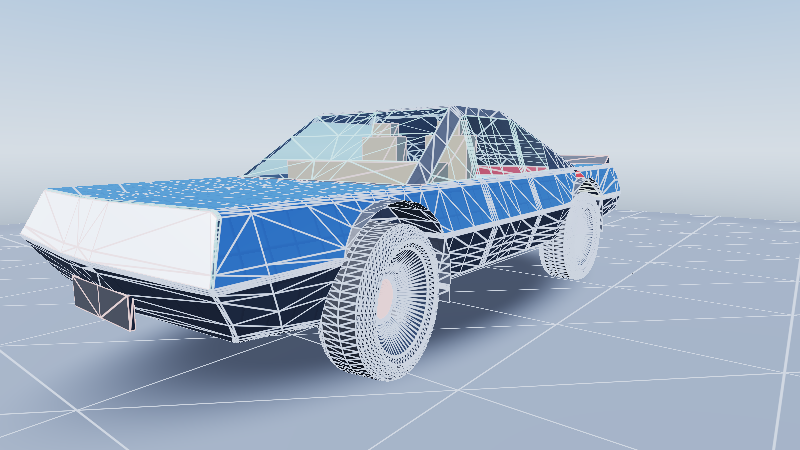

# Cluster-DAG, Material Virtualization, `ControlVehicle`, & Editor/Development `DiagnosticRaster` Exhibits

End-to-end CPU + Vulkan 1.3 Slang compute verification for Frontier's glass-aware QEM Cluster-DAG, 3-tier virtualized
materials (`FullStrata` / `FilteredToksvig` / `CompactProxy`), `64 KB` page residency & RAM/VRAM telemetry, binary `FCT1`
`ControlVehicle{Body,Rim,Tyre}.facet` assembly, `ThemeStructure`-bound card tokens, and Editor/Development-only
(`#if FRONTIER_EDITOR`, zero code in Shipping) `DiagnosticRaster`.

## Vulkan 1.3 Diagnostic Captures (`800x450`)

| Capture | Verified Systems Shown |
|---|---|
|  | **Shaded Preview (`ControlVehicleShadedPreview.png`)**: Analytic physical sky/atmosphere + solar disc, clearcoat automotive paint (`FullStrata`), 2-layer dielectric glass refraction (`IOR = 1.52`), visible interior cabin behind glazing, and ground contact shadow. |
|  | **Cluster Identity (`ControlVehicleClusterIdentity.png`)**: Per-cluster golden-ratio ID palette across body, rims, tyres, and plinth, plus translucent cyan glazing showing interior clusters surviving two-phase opaque-only Hi-Z culling. |
|  | **Shaded + Cluster Wireframe (`ControlVehicleHierarchyAndWireframe.png`)**: Anti-aliased `1 px` screen-space barycentric triangle edges colored by QEM hierarchy tier over shaded automotive surfaces. |
|  | **Two-Layer Glass Peel (`ControlVehicleGlassLayerPeel.png`)**: Single-layer cyan vs two-layer amber-gold dielectric glazing thickness peel over surviving interior cabin geometry. |
