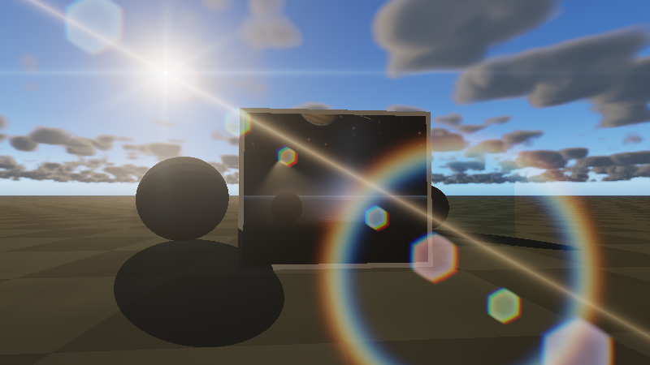
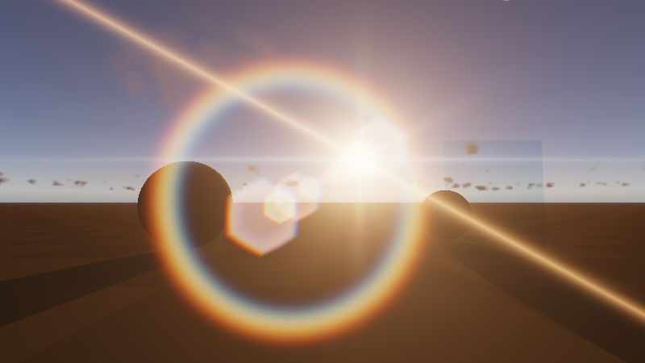
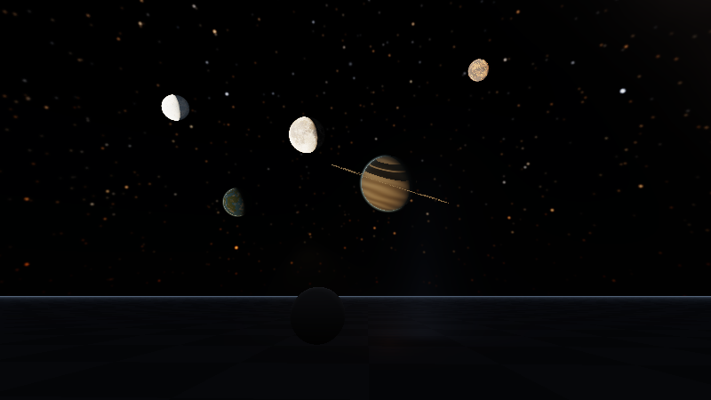
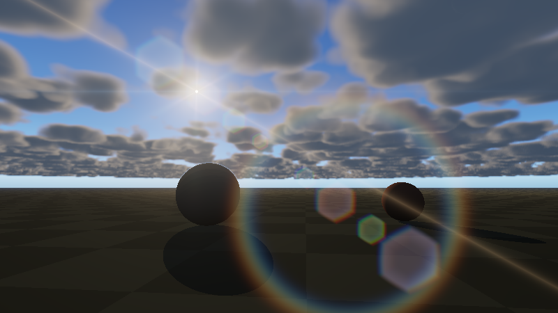
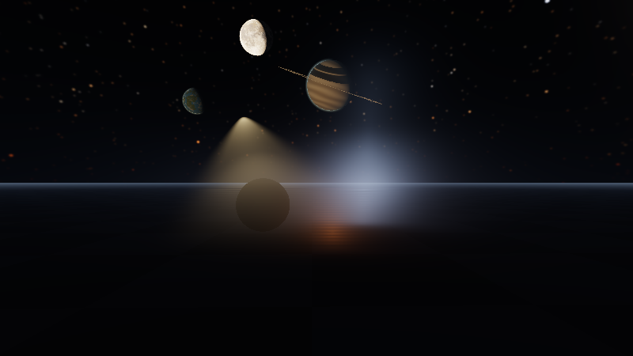
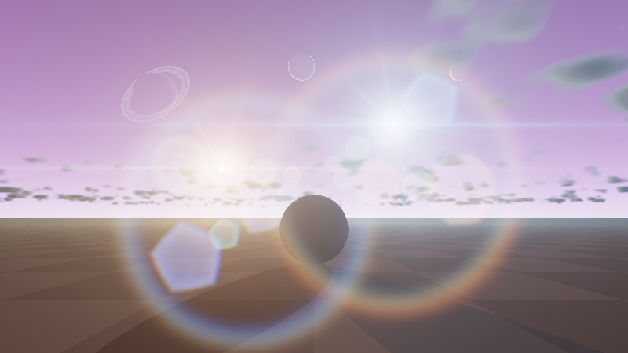

# Unified Multi-Realm Environment & Celestial Rendering Exhibits

End-to-end CPU oracle and Vulkan 1.3 Slang/SPIR-V compute verification for Frontier's multi-instance, portal-routed
Environment & Celestial Rendering stack (`Frontier/Engine/Rendering/`).

## Reproduction

```bash
python3 Automation/PrepareVulkanCompute.py
cmake -B build -G Ninja -DCMAKE_BUILD_TYPE=Release -DGLFW_BUILD_WAYLAND=OFF -DGLFW_BUILD_X11=OFF
cmake --build build --target FrontierEnvironmentShaders EnvironmentRealmValidation -j$(nproc)
./build/EnvironmentRealmValidation . ./build/ShaderArchives/Environment ./build/Testing/environment-realm-exhibits --write-showcase
ctest --test-dir build --output-on-failure
```

- **Host & Toolchain:** Linux x86_64, GCC 12.2.0 (`-std=c++20 -O3 -Wall -Wextra -Werror`), Slang `2026.14.1`
  (`-target spirv -profile spirv_1_3 -emit-spirv-directly -O0`), Vulkan 1.3 software compute execution on
  `SwiftShader Device (Subzero)` (`VK_PHYSICAL_DEVICE_TYPE_CPU`).
- **Scope note:** GPU captures below are real Vulkan 1.3 `RGBA16F` compute dispatches and readbacks executed on
  SwiftShader CPU Vulkan; native Windows discrete RTX/GTX hardware captures remain a separate verification step.

## Measured Results

| Verification Domain | Target / Contract | Observed Result |
|---|---|---|
| Coupled Sun/Sky NEE (`SolarSkyEnvironment`) | `< 2.85%` max relative error vs FP64 continuum oracle | **2.80153%** across 16 day, golden-hour, and `-2.5°` civil-twilight rays |
| Finite-Pixel Solar Disc (`SolarDiscPixelFilter`) | Energy conservation across coarse & fine angular pixels | Passed (`< 0.1%` integrated irradiance drift) |
| Celestial Dome (`CelestialDomeModel` + GPU) | Meeus Ch. 47 ephemeris, `2048x1024x6` sRGB lunar atlas, Hipparcos stars, ringed planets | **41,359** octahedral cell-indexed stars + 6 lunar body layers uploaded & verified |
| Dirty-Gated Multi-Realm LUTs (`AtmosphereLutSubmission`) | `256x64xR` Transmittance, `32x32xR` Multi-Scatter, `192x108xR` Sky-View | Initial 3 realms = **3** bakes; steady frame = **0** bakes; single-realm edit = **1** bake |
| Volumetric Clouds & Ortho Shadows (`VolumetricCloudSequence`) | Global slabs + bounded local 3D boxes + `256x256xR` `CloudShadowProjection` | Realm 0 cloud shadow transmittance `< 0.75`; cloud-free Realm 1 = `1.000` |
| GPU 1x1-Per-Source Lens Flare (`OpticalLensFlareSequence`) | Open sky, reversed-Z sphere, tinted glass, volumetric cloud, cross-realm portal clipping | All 5 physical occlusion & spectral transmittance readback checks passed |
| Cross-Realm Portal Routing (`EnvironmentRealmEnsemble`) | Simultaneous daytime exterior (`Realm 0`) + starry night interior (`Realm 1`) | G-Buffer layer 1 & HDR readback verified in single Vulkan frame |

## Vulkan 1.3 Showcase Captures (`800x450`)

| Capture | Verified Systems Shown |
|---|---|
|  | **Simultaneous Day/Night Cross-Realm Portal (`DayNightPortalEnsemble.png`)**: Daytime `Realm 0` exterior (blue sky, Perlin-Worley cumulus clouds, ortho ground shadows, dielectric glass pane, 6-blade hexagonal chromatic lens flare) routing rays through `PortalAperture` into `Realm 1` starry night (ringed gas giant, Hipparcos stars, IES spotlight cone, lightning scatter). |
|  | **Twilight Atmosphere & Lens Flare (`TwilightAtmosphereAndLensFlare.png`)**: Coupled Chappuis ozone twilight sky, golden-hour horizon scattering, rose-lit cumulus clouds, dielectric glass pane, and full chromatic ghost train + antipode spectral halo + warm & anamorphic streaks + diffraction starburst. |
|  | **Celestial Dome (`CelestialDomeMoonsPlanetsStars.png`)**: 41,359 cell-indexed Hipparcos stars with Kolmogorov scintillation, Milky Way band, `2048x1024x6` lunar atlas spheres (`LunaSelenographic`, `GlacierEuropa`, `EmberVolcanic`) with phase & earthshine, ringed banded gas giant with ring shadow, and oceanic terrestrial exoplanet. |
|  | **Volumetric Clouds & Ortho Shadows (`VolumetricCloudsAndOrthoShadows.png`)**: Dual-domain 3D Perlin-Worley ray-march combining a near bounded 3D local cloud volume and planetary cumulus slab with 2-octave Beers-Powder silver lining, realm/depth-aware bilateral reconstruction, and orthographic ground shadows. |
|  | **Coupled Volumetric Fog (`VolumetricFogLuminairesAndShafts.png`)**: Analytic height fog + planet-curved aerial perspective + 3D noise-modulated froxel fog scattering photometric IES spotlight cones, lightning channel radiance, and radiant thermal fire facets beneath the night dome. |
|  | **Binary-Sun Exoplanet Ensemble (`BinarySunExoplanetEnsemble.png`)**: Non-Earth violet Rayleigh atmosphere (`Realm 2`) illuminated simultaneously by two suns (8-blade warm star + 5-blade blue star) with dual pentagonal/octagonal chromatic lens flares, ringed methane ice giant, and `Europa`/`Io` moons. |
