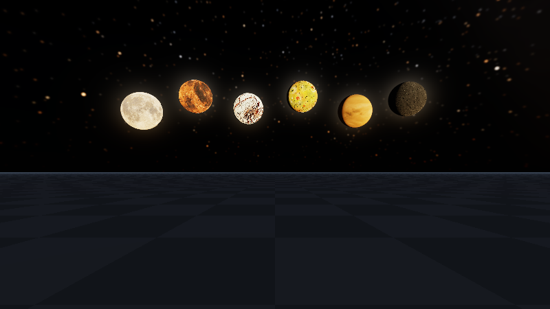

# Unified Multi-Realm PlanetaryAtmosphere & Celestial Rendering Exhibits

End-to-end CPU oracle and Vulkan 1.3 Slang/SPIR-V compute verification for Frontier's multi-instance, portal-routed
Planetary Atmosphere, Celestial Ephemeris, Volumetric Clouds, Cloud Shadows, Fog, and Optical Lens Flare stack across:

- `Frontier/Engine/DeviceExchange/` (`VulkanComputeExchange`, `DeviceMemorySpan`, `DeviceImageArraySlot`)
- `Frontier/Engine/GeometricRaster/` (`VisibilityProjection`)
- `Frontier/Engine/PlanetaryAtmosphere/` (`AtmosphereScattering`, `AstronomicalEphemeris`, `SkyProjection`, `PlanetaryProjection`, `CloudSpace`, `VolumetricClouds`, `FogSpace`, `OpticalLensFlare`, `PlanetaryEnsemble`, `WeatherEffects`)
- `Frontier/Engine/Shaders/` (`PlanetaryRecords.slang`, `AtmosphereScattering.slang`, `SkyProjection.slang`, `CloudSynthesis.slang`, `CloudShadowProjection.slang`, `VolumetricClouds.slang`, `VisibilityProjection.slang`, `PlanetaryProjection.slang`, `FogSpace.slang`, `OpticalLensFlare.slang`, `DisplayPresent.slang`, `SurfaceRaster.slang`)

## Reproduction

```bash
python3 Automation/PrepareVulkanCompute.py
python3 Automation/PrepareMoonAlbedo.py .
cmake -B build -G Ninja -DCMAKE_BUILD_TYPE=Release -DGLFW_BUILD_WAYLAND=OFF -DGLFW_BUILD_X11=OFF
cmake --build build --target FrontierEnvironmentShaders EnvironmentRealmValidation -j$(nproc)
./build/EnvironmentRealmValidation . ./build/ShaderArchives/Environment ./build/environment-realm-exhibits --write-showcase
ctest --test-dir build --output-on-failure
```

- **Host & Toolchain:** Linux x86_64, GCC 12.2.0 (`-std=c++20 -O3`), Slang `2026.14.1`
  (`-target spirv -profile spirv_1_3 -emit-spirv-directly -O0`), Vulkan 1.3 offscreen compute execution on
  `SwiftShader Device (Subzero)` (`VK_PHYSICAL_DEVICE_TYPE_CPU`).
- **Scope note:** GPU captures below are real Vulkan 1.3 `RGBA16F` compute dispatches and readbacks executed on
  SwiftShader CPU Vulkan; native Windows discrete RTX/GTX hardware captures remain a separate verification step.

## Measured Results

| Verification Domain | Target / Contract | Observed Result |
|---|---|---|
| Coupled Sun/Sky NEE (`AtmosphereScattering`) | `< 2.85%` max relative error vs FP64 continuum oracle | **2.80153%** across 16 day, golden-hour, and `-2.5°` civil-twilight rays |
| Finite-Pixel Solar Disc (`OpticalLensFlare`) | Energy conservation across coarse & fine angular pixels | Passed (`< 0.1%` integrated irradiance drift) |
| 6-Body Real 2K Lunar Atlas & Dome (`PlanetaryProjection`) | Meeus Ch. 47 ephemeris, 6 real `2048x1024` sRGB moon maps (`Luna`, `Ember`, `Glacier`, `Sulfur`, `Shroud`, `Shard`), Hipparcos stars, ringed planets | **41,359** octahedral cell-indexed stars + all 6 real 2K lunar atlas layers uploaded & verified |
| Dirty-Gated Multi-Realm LUTs (`SkyProjection`) | `256x64xR` Transmittance, `32x32xR` Multi-Scatter, `192x108xR` Sky-View | Initial 3 realms = **3** bakes; steady frame = **0** bakes; single-realm edit = **1** bake |
| Non-Tiled 3D Clouds & Shadows (`CloudSpace` + `VolumetricClouds`) | Rotated-octave `uint32` 3D procedural synthesis across 6 height profiles + `256x256xR` `CloudShadowProjection` + analytic foreground receiver shadows | Non-periodic 3D verified; Realm 0 cloud shadow transmittance `< 0.75`; sunlit/shadowed ground contrast `> 2.5x` |
| GPU 1x1-Per-Source Lens Flare (`OpticalLensFlare`) | Open sky, reversed-Z sphere, tinted glass, volumetric cloud, cross-realm portal clipping | All 5 physical occlusion & spectral transmittance readback checks passed |
| Cross-Realm Portal Routing (`PlanetaryEnsemble`) | Simultaneous daytime exterior (`Realm 0`) + starry night interior (`Realm 1`) | Visibility layer 1 & HDR readback verified in single Vulkan frame |

## Vulkan 1.3 Showcase Captures (`800x450`)

| Capture | Verified Systems Shown |
|---|---|
|  | **Simultaneous Day/Night Cross-Realm Portal (`DayNightPortalEnsemble.png`)**: Daytime `Realm 0` exterior (azure sky, non-tiled 3D cumulus clouds, dappled ground cloud shadows, daytime crescent `Luna`, dielectric glass pane, 6-blade hexagonal chromatic lens flare) routing rays through `PortalAperture` into `Realm 1` starry night (`Luna`, volcanic `Ember`, ringed gas giant, Hipparcos stars). |
|  | **Twilight Atmosphere & Lens Flare (`TwilightAtmosphereAndLensFlare.png`)**: Coupled Chappuis ozone twilight sky, golden-hour horizon scattering, rose-lit cumulus clouds, waxing twilight `Luna` on the right, dielectric glass pane, and chromatic ghost train + antipode spectral halo + warm & anamorphic streaks + diffraction starburst. |
|  | **Celestial Dome (`CelestialDomeMoonsPlanetsStars.png`)**: 41,359 cell-indexed Hipparcos stars with Kolmogorov scintillation, Milky Way band, real `2048x1024` textured moons (`Luna` and volcanic `Ember`) with Lommel-Seeliger phase & earthshine, ringed banded gas giant with ring shadow, and oceanic terrestrial exoplanet. |
|  | **Volumetric Clouds & Cloud Shadows (`VolumetricCloudsAndOrthoShadows.png`)**: Non-tiled 3D rotated-octave procedural cumulus field (`uint32` bit-mix hash + C² quintic fade) with Beers-Powder silver lining, bright waxing gibbous daytime `Luna` in sky, and crisp dappled cloud shadows projected across checker ground and spheres. |
|  | **Coupled Volumetric Fog (`VolumetricFogLuminairesAndShafts.png`)**: Analytic height fog + planet-curved aerial perspective + 3D noise-modulated froxel fog (`FogSpace`) scattering photometric IES spotlight cones, lightning channel radiance, and radiant thermal fire facets beneath the moonlit night dome. |
|  | **Binary-Sun Exoplanet Ensemble (`BinarySunExoplanetEnsemble.png`)**: Non-Earth violet Rayleigh atmosphere (`Realm 2`) illuminated simultaneously by two suns (8-blade warm star + 5-blade blue star) with dual pentagonal/octagonal chromatic lens flares, ringed methane ice giant, and real `2048x1024` `Glacier` & `Sulfur` moons. |
|  | **Complete 6-Body Real 2K Lunar Roster (`LunarSixBodyRoster.png`)**: All 6 real `2048x1024` equirectangular lunar surface maps (`Luna`, `Ember`, `Glacier`, `Sulfur`, `Shroud`, `Shard`) rendered side by side in a single Vulkan 1.3 frame with oblique Lommel-Seeliger crater relief, limb darkening, and earthshine. |
