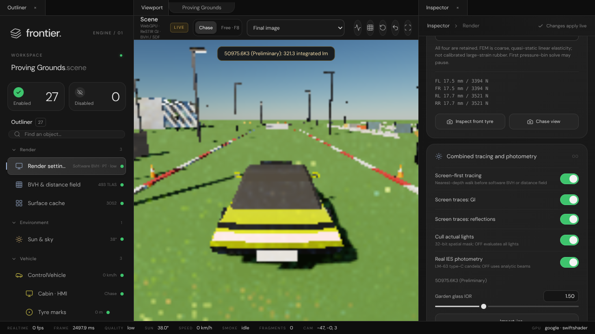

# Combined renderer regression repair

Executed 2026-10-20 on Linux x86_64, Node 22.22.3, Dawn webgpu 0.6.2,
Vulkan SwiftShader and Chromium 153. Working branch `arena/8cbe5e29-frontier`,
uncommitted browser changes based on `e016a0bf43e7229254e7e88847cd31980ea17a24`.
No C++ conversion, native binary, GitHub Actions or push.

## Why the combined version was slow and buggy

| Finding | Repair |
| --- | --- |
| Tyre deformation and derivative normals evaluated inside ray/triangle candidate traversal, repeatedly for every ray; wheel bounds expanded by 25 cm | Independent wheel BLAS copies, deform unique rest vertices once per changed shape, bottom-up tight bounds; cache rest projections and skip unchanged uploads |
| Default SDF/screen route differed from the c7 software-BVH demo | Restore BVH default; keep SDF and screen-first as explicit comparison controls |
| Cluster-mask work repeated inside light loops | Compute masks once per shading point; stop card lighting at first inactive compact light record |
| Screen-space misses/invalid samples could suppress world tracing | Explicit coverage/validity propagation and world fallback |
| Direct specular entered diffuse GI history and was added again during recombination | Diffuse-only direct history and explicit direct-specular separation |
| Skipped passes could expose stale GPU timestamps | Register query sets only when the pass is actually submitted |

The independent wheel copies increase stored triangle count, not visible wheel count.
The integrated scene also adds four occupants and 2,316 rest triangles/material work versus the donor.
The fixes do **not** establish identical workload or estimator equivalence.

## Measured renderer comparison

Pinned c7 donor: `c7egoist/Frontier`, branch `arena/21530081-frontier`,
commit `21c553b620c1aca3ae3a794ee369b4edaa337361`.
Matched settings: 64×64 output / 32×32 trace, low quality, scale .25, stress pool 8,
frozen spring model, software BVH, one GI/reflection bounce and candidate;
screen-first, IES and clustering OFF. Eight-frame harness, three raw GPU timestamp samples per named pass.

| Median GPU pass, ms | c7 donor | Combined before | Repaired | Before / repaired |
| --- | ---: | ---: | ---: | ---: |
| Direct | 216.203 | 1553.400 | 209.453 | 7.42× |
| ReSTIR GI | 105.120 | 440.402 | 138.805 | 3.17× |
| Reflection | 18.612 | 168.231 | 48.824 | 3.45× |

[Donor raw](Results/RendererRepair/Baseline.json) ·
[Before raw](Results/RendererRepair/Before.json) ·
[Repaired raw](Results/RendererRepair/After.json).
These are tiny software-adapter pass probes, **not hardware FPS or whole-frame time**.
GI is still 1.32× donor cost, reflections 2.62×; full donor parity is not claimed.
Startup/card-lighting samples are highly variable. Do not sum these passes or historical stale queries.
The final GPU capture precedes the CPU-only rest-projection caching optimisation;
that optimisation leaves WGSL and the GPU workload unchanged and has subsequent regression coverage.

### CPU work moved out of ray traversal

[Real-geometry refit measurements](Results/RendererRepair/WheelRefitCpu.json):
60 moving-angle samples/model, all four authored wheels, 5,536 triangles/wheel,
mock queue, CPU only. Median milliseconds per four-wheel update:

| Spring | XPBD | Shell | Solid |
| ---: | ---: | ---: | ---: |
| 9.377 | 8.122 | 17.287 | 17.209 |

This excludes upload, rendering and physics; it is a remaining bottleneck, not free work.
Unchanged shapes skip refits. Target-hardware FPS still needs measurement.

## Verification and visible evidence

- Latest [combined summary](Results/Combined/Summary.json): **87 tests**, four model stability programs,
  seven Dawn-null scenarios / 178 frames pass. Null checks validate wiring, not pixel accuracy.
- [Actual browser controls](Results/RendererRepair/Browser/BrowserValidation.json): empty errors list,
  BVH/SDF and feature controls exercised. [Rendered scene](Results/RendererRepair/Browser/CombinedControls.png).
- [Four-model browser validation](Results/TyreModels/BrowserTyreModels.json): all four models rendered with BVH,
  empty errors list. See adjacent screenshots.
- [Production WGSL/CPU parity](Results/RendererRepair/WheelDeformationParity.json): 385 vertices/model,
  all four pass 0.3 mm position / .003 normal tolerances. Worst measured position difference .095 mm
  (SwiftShader trigonometry); this is not bitwise parity. Cached/uncached projection equivalence has a unit test.
- Solid FEM donut mirror drift repaired by simultaneous symmetric axle updates; original 5% threshold retained.



## Four selectable tyre models

Render settings → Tyre model → Inspect front tyre; same selection under Vehicle → Tyres.
Spring and XPBD retained. Newly authorised shell: 112 nodes / 192 triangles;
solid: 224 nodes / 576 tetrahedra, inflation/contact, approximate inflated-reference prestress/gas.
They are coarse linear quasi-static models, not calibrated nonlinear dynamic rubber/cord;
one-layer solid elements can lock. MF6.1 supplies tangential forces.
Pressure interpolation is continuous; table-node residual is not an intermediate-pose KKT residual.

[CPU physics comparison](Results/TyreModels/CpuTyreModels.json), seven repetitions × 2,400 steps,
rendering/refit excluded: spring 304.909 ms, XPBD 329.182 ms, shell 458.825 ms, solid 443.133 ms medians.
Different illustrative stiffnesses mean these are not accuracy rankings.
Solid cold construction was 1,159 ms; shell 104 ms. Model-switch/startup cost remains visible.

## Reproduce

From repository root, restore app dependencies using its lockfile, then:

```sh
python Experimental/IlluminationPrototype/Tools/VerifyCombined.py --install
node Experimental/IlluminationPrototype/Tools/ProfileWheelRefit.mjs
cd Experimental/IlluminationPrototype
LD_LIBRARY_PATH=/tmp VK_ICD_FILENAMES=/tmp/vk_swiftshader_icd.json BACKEND=vulkan SIZE=64x64 HARNESS_TIMEOUT=240000 HOOKS=Tools/RendererBenchmarkHooks.mjs BENCH_OUT=after.json OUT=after.png node Tools/HeadlessHarness.mjs . 8 '?capture=1&quality=low&scale=0.25&renderer=bvh&stresspool=8&bounces=1&reflbounces=1&candidates=1'
cd Tools
node BrowserEnvironment.mjs
BROWSER_VALIDATION=BrowserTyreModels.mjs node BrowserEnvironment.mjs
LD_LIBRARY_PATH=/tmp VK_ICD_FILENAMES=/tmp/vk_swiftshader_icd.json node ValidateWheelDeformation.mjs
node CompareTyreModels.mjs
```

Vulkan commands require a compatible Dawn runtime/SwiftShader ICD and shared libraries;
`/tmp` paths describe this test environment, not bundled dependencies.
The pinned donor and historical before snapshot require their respective source states to repeat baseline runs;
retained JSON is the executed historical evidence, not a claim that current source reproduces the old bug.
See the [application README](../../Experimental/IlluminationPrototype/README.md) for launch instructions.
Hard-refresh the existing port-8080 preview to discard cached modules.
Hardware/Windows compatibility, subjective image/driving acceptance, accuracy calibration and C++ remain open.
