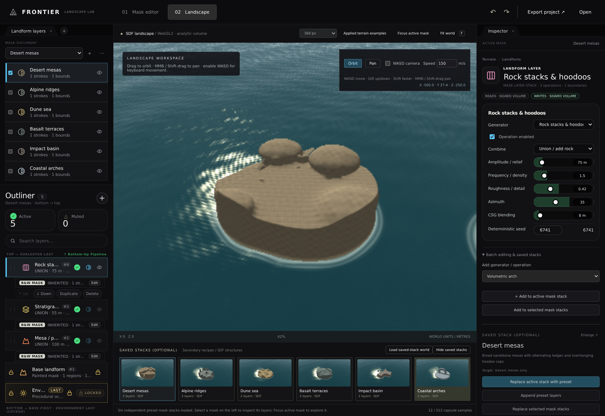
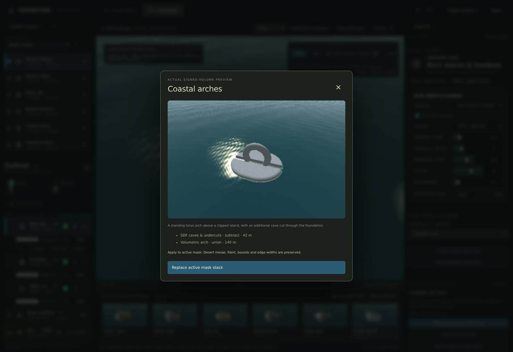

# Mask-owned landform stacks and rendered presets

## Outcome — mask ownership verification, 2026-11-06

The later correction adds applied noise terrain, navigation and source-aligned controls. See
[`TerrainGenerators.md`](TerrainGenerators.md) for current 44-unit / 36-browser-check totals and primary captures.
The mask-stack checks below still pass; the preset-first workflow is now secondary.

| Verification                                   | Observed result                                    |
|------------------------------------------------|----------------------------------------------------|
| Local field / stack / sparse export suite       | 44 / 44 passed                                     |
| Existing browser regression suite              | 12 / 12 passed against built Vite output            |
| Focused mask-stack browser suite               | 15 / 15 passed against built Vite output            |
| Mask-owned CPU/GPU distance probes              | 216 across nine families; max error 0.000522         |
| Six actual preset thumbnails                   | Captured from WebGL2; production asset loading passed |
| Pinned source fingerprints                     | All three Git blob identities match                |
| Production bundling                            | Passed, including background sampler and six images |
| Current actual application captures            | `MaskLayerStacks.png`, `PresetLibrary.png`           |
| Native Windows editor / physical GPU speed     | Not tested                                         |

`MaskStackBrowserResults.json` retains individual current outcomes and the exact measured error.
`LandformFieldResults.tap` retains all 44 local test results. `BrowserResults.json` retains twelve general checks,
including a complete 1024 × 128 × 1024 background bake and 4096 cancellation.
Earlier `LandformBrowserResults.json`, `LandformLandscape.png`, and `BoundaryStacks.png` are historical evidence of the
superseded boundary-owned UI; they do not verify the current mask-owned stack implementation.

## Ownership and behaviour exercised

- Each mask owns one `Layer.Landforms` stack, applied within all its boundaries. The active mask expands its hierarchy
  on the left: newest operation on top, painted foundation below. Its selected operation is edited in the inspector.
- Add/edit/reorder/enable/delete changes the active mask, not the selected boundary or another mask. Empty masks can
  have a stack before paint or boundaries exist. Switching masks restores their independent stacks.
- Boundary selection changes only edge controls. Edge zero keeps sharp geometry; positive widths smoothly intersect
  inward and may remove narrow islands. Strokes, erased holes and region bounds always clip the resulting volume.
- Explicit batch actions target checked masks, clone recipe/operation data independently, exclude unselected masks,
  and reject all targets atomically on validation failure. Primary active-mask actions stay active-only even when
  several masks are checked.
- Six rendered recipe cards select without applying. Replace/append is explicit; masks, paint, bounds, edge widths,
  colour and sampling settings are preserved. Double-click/enlarge reveals the actual preview and operation list.
- **Load example world** explicitly confirms replacement, creates six separately editable masks and is undoable.
  Header undo/redo controls stay visible in either workspace. **Focus active mask** and **Fit world** frame their
  scopes.
- Existing `Region.Landforms` imports remain legacy post-mask modifiers, with an explicit removal action. No operation
  is silently discarded. Combined mask/legacy count is limited to eight operations per evaluated boundary.
- Export/import, autosave/reload, undo/redo, parent-mask stack inclusion in real worker bakes, no neighbour legacy
  leakage, true void-under-roof geometry, cache edits and conservative sparse reconstruction are covered.

## Presets and source adaptation

| Recipe          | Ordered geometric operations                   |
|-----------------|------------------------------------------------|
| Desert mesas    | Mesa → stratigraphic ledges → rock stacks      |
| Alpine ridges   | Fault shoulder → arête ridges                  |
| Dune sea        | Two seeded dune populations                    |
| Basalt terraces | Fault escarpment → stepped beds → cave cut     |
| Impact basin    | Raised mesa → crater subtraction               |
| Coastal arches  | Vertical torus arch → foundation cave cut     |

Requested reference: `https://github.com/c7egoist/Frontier/tree/arena%2F68c84c0d-frontier`.
Immutable pin: `09b7064f282f4df5c5352f2bc97c82fb1c06a098`, also in `CLAUDE.md` and
`Experimental/LandscapeWorkspace/ReferenceSnapshot/SourcePin.json`.

Original sources remain unchanged with verified Git blob identities. The five basic procedural family names,
relevant defaults and bottom-to-top conventions inform the local adapter. Reference height-texture shaders are not
runtime imports. Local conic peaks/spurs, rounded blocks, normalised half spaces, conservative ellipsoids, capsule
cuts and torus arches are combined as true signed 3D fields. These recipes are **not** a complete reference-generator
port, heightmap pipeline, physical erosion/sedimentation simulation, or guarantee of visual/numeric parity.

## Environment and reproduction

Linux x64 / Debian 12; Node.js 22.22.3; Vite 7.3.7; Playwright 1.65.0; Chromium 153 / ANGLE SwiftShader.
Session branch `arena/6c0074b7-frontier`, starting revision `e1ce5629e8927ea1fc1b11646df21e7332687e68`.
Changes remain cumulative and uncommitted; no GitHub Actions or native Windows build were run.

```bash
cd Experimental/LandscapeWorkspace
npm ci
npm test
npm run build
npm install --no-save --package-lock=false @sparticuz/chromium@153.0.0
npm exec vite preview -- --host 0.0.0.0 --port 5174
```

From repository root, with NSS/NSPR installed as described in the exhibit `README.md`:

```bash
LD_LIBRARY_PATH=/tmp/lib LANDSCAPE_URL=http://localhost:5174 \
  node Exhibits/LandscapeWorkspace/MaskStackBrowserValidation.mjs
LD_LIBRARY_PATH=/tmp/lib LANDSCAPE_URL=http://localhost:5174 \
  node Exhibits/LandscapeWorkspace/BrowserValidation.mjs
```

Retain the local test report:

```bash
cd Experimental/LandscapeWorkspace
node --test --test-reporter=tap FieldValidation.test.js SparseVolume.test.js \
  LandformStack.test.js MaskLayerStack.test.js TerrainNoise.test.js > ../../Exhibits/LandscapeWorkspace/LandformFieldResults.tap
```

To regenerate actual preset images, run the dev server on 5173 and, from root:

```bash
LD_LIBRARY_PATH=/tmp/lib node Exhibits/LandscapeWorkspace/GeneratePresetPreviews.mjs
```

The generator renders `PresetExamples.html` with the real volume rasterizer, reads PNGs from its WebGL canvas,
then writes all images after closing the browser to avoid Vite hot reload during capture. No artistic image generator
or mocked terrain thumbnails are used. Each recipe is captured in the same camera/paint/edge setup for comparison.

## Limits and rendering

- GPU and worker use the same compiled 3D primitives. Bounds include relief, displacement and slope-aware CSG blend
  support. CSG fields are conservative, not globally re-distanced exact Euclidean fields.
- Nine basic adapters; eight combined operations per boundary, 2048 primitives/document, 512 capsule samples,
  16 masks, 16 boundaries/mask; 256 MiB raw encoded bake budget. Intricate exports can fail explicitly.
- Software auto width is 360 pixels, or 240 above three masks; hardware auto width is 1200. The quality selector can
  override this. One in-flight GPU fence prevents queued application draws; software updates at most once/s.
  Conservative per-region lower bounds skip field evaluation when the region cannot beat the current distance.
- Current UI capture is an actual 1600 × 1100 browser image at explicit 360 internal render width; thumbnails use
  actual 360-pixel canvas renders. This is software validation, not a physical GPU speed/quality benchmark.
- Physical erosion, baked-volume visualization, native integration and complete nineteen-generator parity remain open.

## Actual rendered evidence




