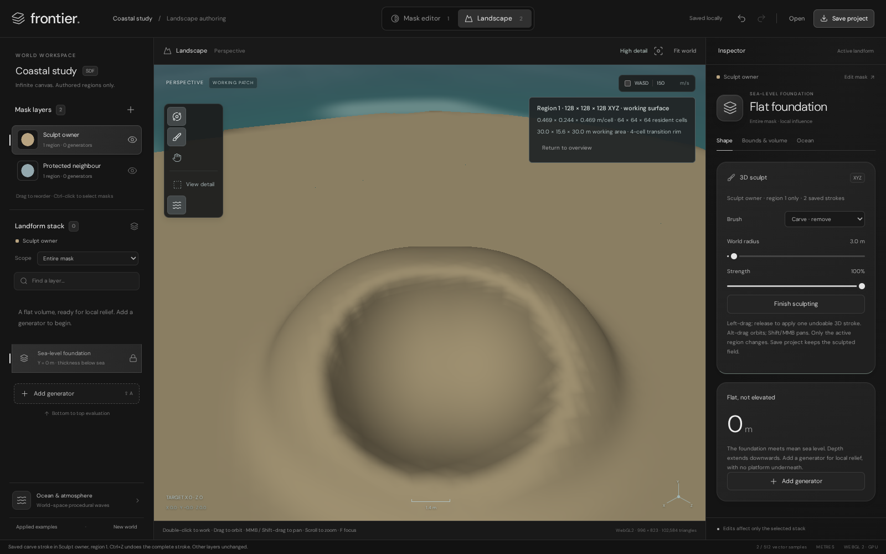
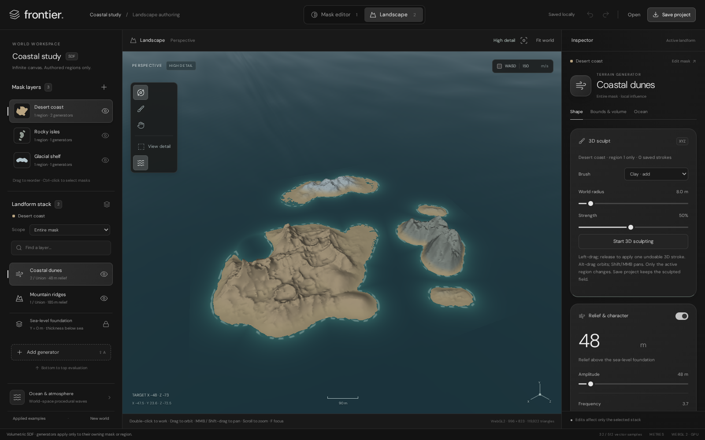

# Landscape workspace — 3D sculpting and always-high geometry

**Clay and Carve now edit the genuine XYZ field. High geometry is the default, not an image-width option.**
The focused sculpt checks pass in development and the built application, including negative-Y underside carving.
**GPU stability is not resolved:** the broad editor regression still hit the unchanged four-second fence stop.

These are actual browser captures, not native-editor or physical Windows GPU certification. The lab uses
Chromium 153 with ANGLE/Vulkan/SwiftShader behind WebGL2. That driver is not an application CPU pixel fallback.



[Clay capture](Images/GpuSculptClay.png) · [underside capture](Images/GpuSculptUnderside.png) ·
[high whole-scene capture](Images/GpuSculptHigh.png) · [development report][sculpt] ·
[built sculpt report](Results/ProductionGpuSculpt.json).

## Current verification

| Verification                       | Development        | Built application | Evidence                  |
| ---------------------------------- | ------------------ | ----------------- | ------------------------- |
| Units                              | **183/183**        | —                 | [TAP][units]              |
| Production build                   | **2,044 modules**  | —                 | [Build][build]            |
| Sculpt, persistence and high detail | **10/10**          | **10/10**         | [Sculpt][sculpt]           |
| Actual GPU surface/lifecycle        | **12/12**          | **12/12**         | [Surface][surface]        |
| Per-region working resolution       | **10/10**          | **10/10**         | [Working][working]        |
| Completed sampling/working zoom     | **6/6**            | **6/6**           | [Sampling][sampling]      |
| Quality and world-space water       | **3/3**            | **3/3**           | [Quality][quality]        |
| Fail-closed and no-animation path   | **5/5**            | **5/5**           | [Failure][failure]        |
| Broad editor regression             | **Failed after 11** | —                | [Editor][editor]          |
| Metric-export UI                    | **7/7**            | —                 | [Metric UI][metric-ui]    |
| Built UI/fonts/metric export        | —                  | **3/3**           | [Production][built]       |
| Independent distance fixtures       | **6 + 3 grids**    | —                 | [Numeric][numeric]        |
| Full metric export                  | **1024×128×1024**  | —                 | [Volume][volume]          |
| Isolated HTML/editor resume         | **Passed**         | —                 | [Resume][isolated]        |

The latest broad editor run stopped while hiding all masks: zero prepared terrain triangles, two draw calls,
one pending image, and the four-second fence limit. The initial long batch also failed at this point; its
[original telemetry](Results/GpuEditorSculptBatchFailure.json) is retained separately.
The [latest failed-editor capture](Images/GpuEditorSculptFailure.png) is also retained. This is not a passing
full-editor acceptance or proof of the physical cause. No deadline, assertion, fallback or restart policy was relaxed.

An intervening isolated run reached 19 checks before inspecting file-import status before its asynchronous read
completed. Its [report](Results/GpuEditorImportWaitFailure.json) is retained. That test now waits for the actual
error status; its final checks remain unverified in the latest run because the earlier GPU stop occurred again.
The [pre-sculpt two-page resume failure][resume] is also retained, not rerun or erased by a passing isolated check.

Built reports: [surface](Results/ProductionGpuSurface.json), [working](Results/ProductionGpuRegionResolution.json),
[sampling](Results/ProductionGpuPreviewSampling.json), [quality](Results/ProductionGpuQuality.json),
[failure](Results/ProductionGpuFailure.json), and [sculpt](Results/ProductionGpuSculpt.json).
Reports record tested source SHA256 fingerprints; the production report also records built-asset hashes.
[Evidence integrity audit](Results/SculptEvidenceAudit.json) verifies current bytes and explicitly keeps overall
acceptance **blocked**. Reproduce it with `node Exhibits/LandscapeWorkspace/SculptEvidenceValidation.mjs`; it
does not rerun tests or turn the editor failure into a passing acceptance.

## What changed in the geometry



| Same coastal document/camera, 1600×1000 DPR 1 | Previous built application | Current high default |
| ------------------------------------------ | -------------------------- | -------------------- |
| Actual GPU image                           | 996 × 823                  | 996 × 823            |
| Terrain triangles                          | 96,798                     | **119,922**          |
| Field samples                              | 308,700                    | **801,701**          |
| Shared-edge splits                         | None                       | **33,122**           |
| Field-projected vertices                    | None                       | **59,972**           |
| Authored coastal document                   | Unchanged                  | Unchanged            |

[Actual preceding-build capture](Images/GpuSculptBeforeHigh.png) ·
[preceding-build report](Results/GpuSculptBeforeHigh.json) · [current report][sculpt].
The baseline was captured before rebuilding and retains the preceding production source/asset manifests.
`GpuSculptBaselineCapture.mjs` deliberately expects that old build; do not run it against the new one as a new baseline.

- The whole scene now uses shared-edge adaptive refinement and bounded Newton projection against the actual
  3D field. This changes positions and silhouettes, not just normals or image pixels.
- Preparation starts internally from a 48-cell contour, welds shared vertices and conformingly splits selected edges.
  The coarse surface is **not** uploaded first. The usual 16→48→64 image replacement sequence is removed.
- Diagnostic quality `96` identifies this adaptive method, **not** a uniform 96³ grid or the authored region target.
  The reported 14.479 m initial pitch is not a uniform final spacing. Refinement metadata records the method,
  projected vertices, splits and limits. Native working pitch is reported separately.
- Movement is bounded by local edge length and initial pitch. The sphere unit fixture verifies over 100× lower
  mean zero-set error, maximum residual below 1e−5, paired closed-surface edges, budgets and cancellation.
  This does not certify arbitrary terrain topology, thin features or the absence of all folded faces.
- High mode remains within **120,000 triangles / 1.1 million samples**. It is not a fully resident 2048³ volume.
  The current coastal preparation took 4.669 s development / 4.886 s built in this lab; maximum slices were
  31.2 / 50.1 ms despite the cooperative 6 ms target. These are observations, not physical-GPU speed guarantees.
- Image width is fixed to the high **1440-pixel ceiling**, with no quality dropdown. Actual image dimensions still
  depend on viewport size and measured cost, under 1.5 million pixels. Image density does not change geometry detail.

## Sculpt ownership, persistence and interaction

```text
World-space vector masks ∩ allocated regions
    → independent mask/boundary XYZ operations
    → region-owned XYZ Clay/Carve strokes
    ├→ canonical picking and field normals
    ├→ bounded high geometry / native-pitch working area → GPU rasterization
    └→ immutable snapshot → sparse metric/conservative 3D export
```

| Property              | Implemented behaviour                                                     |
| --------------------- | ------------------------------------------------------------------------- |
| Tools                 | Clay/add and Carve/remove; world radius and strength                       |
| Genuine 3D editing    | Spherical/capsule signed operations; cliffs, cavities and underside normals |
| Scope                | Active visible allocated region only; other regions/layers protected       |
| Gesture              | Coalesced asynchronous canonical picks; release applies one atomic edit     |
| History              | One undo per released stroke; redo restores exact saved XYZ points          |
| Persistence          | Region `SculptStrokes` validate, autosave and round-trip through project files |
| Export               | Same sculpt field and exact brush provenance in sparse-volume specifications |
| Limits               | 256 strokes/region, 2,048 XYZ points/document, 256 points/gesture             |
| Cancellation         | Pointer cancellation, selection changes and navigation never finalize clay |

The browser check changes actual GPU pixels at the same camera for Clay and Carve, verifies unchanged neighbouring
layers, exact two-undo/one-redo documents, real Save/Open, Mask/resume, cancellation and Alt-orbit.
The UI-driven 32³ export is downloaded, decompressed and queried for newly added solid cells.
The underside check orbits below ground, focuses the bottom surface, stores negative-Y carve points and verifies
changed pixels at an unchanged below-ground camera. It is not a height-only edit or a painted overlay.

**Use:** select a region → Landscape → brush button / **B** → Clay or Carve → set radius/strength → left-drag
and release. Alt-drag orbits; Shift/MMB pans; Ctrl/Cmd+Z undoes the entire stroke. Camera pitch now reaches
−1.50…1.50 radians. Finish sculpting and refocus/re-enable the brush to work on an underside or another surface.
Edits appear on release, not continuously during dragging. Smooth, Flatten and adjustable falloff are not implemented;
brush blending currently uses a fixed radius-relative width.

## Native working detail and honest readouts

- Region counts are independent **X/Y/Z**. 512 horizontal by 96 vertical means **512 × 96 × 512**.
- Starting sculpting opens a native-pitch working area. Zooming in also requests native detail automatically when
  orbit falls below `min(PitchX, PitchZ) × 64 × .85`. No extra high-resolution checkbox is required.
- Up to **64³ cells** remain resident at the authored pitch; budgets may reduce coverage to 48³/32³, not relabel
  a coarser pitch as native. Coarser context and a four-cell tetrahedral transition rim remain outside the interior.
- Double-click a surface or use **View authored detail** for an explicit focus. Minimum orbit is now 0.5 m.
  Automatic focus can clamp to a region edge when looking into empty space between layers; explicitly refocus a
  visible surface in that case. Complete camera-driven volume paging remains open.
- Bounds & volume and the viewport report the **GPU-fence-completed** geometry, not a pending upload. Diagnostics
  include browser driver, actual image size, revision/epoch and `sculpt-high-2`.
- The retained 512×96×512 working example has pitch **1.357×3.427×1.143 m** and up to
  **86.875×219.333×73.125 m** coverage. Its dense Float32 target alone would consume 96 MiB; it is not allocated.
  Derived vertical bounds can change Y pitch. Sub-pitch features and universal watertightness are not guaranteed.

## GPU and water policy

- One OffscreenCanvas graphics thread/context, one queued view, one in-flight fenced image; at most 30 Hz submissions.
- At most 4,095 terrain vertices per draw. Geometry preparation is off-thread field work, not CPU pixel rendering.
  Camera/ocean images reuse the prepared surface; there is no procedural terrain marching loop per screen pixel.
- **Four visible seconds per fence, ten per first/current image, four per inspection reply.** Missing APIs, loss,
  timeout and silence stop the preview. Mask/save survive; only explicit Restart GPU preview creates another session.
  Terminating a thread does not guarantee cancellation of already-submitted GPU work.
- Mask/background suspension pauses work and visible deadlines. The broad failure above remains a stability gate,
  not permission to increase deadlines or add automatic recovery.
- Water keeps the same 24 world-space waves, phase, amplitude and fixed 8 km grid across camera dolly.
  Three-distance checks read the actual linked GPU uniforms exactly. Reflection filtering is not displacement.
- Real context loss, missing WebGL/OffscreenCanvas/thread APIs, injected protocol silence and suppressed animation
  callbacks are tested separately. Those passing cases do not establish physical Windows driver stability.

## Export and independent distance evidence

Metric export uses sparse anisotropic 3D fast sweeping, analytic crossing refinement, convergence and preserved signs.
It is approximate metric signed distance, not exact Euclidean distance or a simulation solver.

| Independent fixture               | Maximum absolute error | Mean gradient magnitude |
| --------------------------------- | ---------------------- | ----------------------- |
| Scaled plane                      | 2.19e−8 m              | 1.0000                  |
| Oblique plane                     | 0.0012702 m            | 1.0000                  |
| Quadratic sphere                  | 0.019570 m             | 0.99748                 |
| Anisotropic sphere                | 0.086482 m             | 1.0004                  |
| Torus                             | 0.042289 m             | 0.98130                 |
| Allocated box / analytic exterior | 0.12739 m              | 0.96374                 |

Sphere refinement reduces maximum error **0.069881→0.051223→0.033472 m** at 24³/48³/96³.
The rerun full export represents **134,217,728 cells**, 88,936 leaves, 68,574,181 raw bytes and 7,457,646 gzip bytes.
Two sweep cycles converge with zero sign changes. Estimated working storage is 262,137,728 bytes, not measured RSS.
Same X/Z samples at Y=−50/40/116 m decode solid–air–solid, which a heightmap cannot represent.
The archive stays out of Git; exact timings and measurements are in the [raw report][volume].

## Reproduce

Requires Node.js 22.12+, npm and a Playwright-compatible Chromium. Start development and built servers separately:

```bash
npm --prefix Experimental/LandscapeWorkspace ci
npm --prefix Experimental/LandscapeWorkspace test
npm --prefix Experimental/LandscapeWorkspace run build
npm --prefix Experimental/LandscapeWorkspace run dev -- --port 5173
npm --prefix Experimental/LandscapeWorkspace run preview -- --port 4173
```

Run `test:sculpt`, `test:preview`, `test:working`, `test:sampling`, `test:gpu-quality`, `test:gpu-failure`,
`test:browser`, `test:production`, `test:metric-browser`, `test:metric` and `test:volume` with
`npm --prefix Experimental/LandscapeWorkspace run <command>`. The broad browser command currently fails as described.

Repeat each GPU check against the built server with its own prefix, for example:

```bash
LANDSCAPE_URL=http://127.0.0.1:4173 LANDSCAPE_REPORT_PREFIX=ProductionGpuSculpt \
  npm --prefix Experimental/LandscapeWorkspace run test:sculpt
LANDSCAPE_DIALOG_MODE=editor LANDSCAPE_REPORT_PREFIX=GpuDialogEditorOnly \
  node Exhibits/LandscapeWorkspace/GpuDialogValidation.mjs
```

`PLAYWRIGHT_EXECUTABLE_PATH` selects Chromium. `LANDSCAPE_URL` overrides development; `LANDSCAPE_BUILD_URL` selects
built UI. This lab used `/tmp/chromium` and `LD_LIBRARY_PATH=/tmp/al2023/lib`, not portable installation requirements.
Dependencies, `dist/` and full archives remain ignored. No browser source interception or GPU deadline override
was used.

## Provenance and remaining work

| Property      | Tested configuration                                                   |
| ------------- | ---------------------------------------------------------------------- |
| Date          | 2026-11-07                                                             |
| Branch / HEAD | `arena/ceeabe45-frontier` / `e1ce5629e8927ea1fc1b11646df21e7332687e68` |
| Edits         | Captured before publication: sculpt/high geometry and GPU-only repairs   |
| Runtime       | Linux x64, Node 22.22.3, Vite 7.3.7, Chromium 153.0.8010.0              |
| Graphics      | ANGLE Vulkan / SwiftShader; not a physical Windows GPU                  |
| Source pins   | SDF `09b7064f…`; ProjectZero UI `28ec0657…`; import `4b26efcd…`           |

[Immutable references](../../Experimental/LandscapeWorkspace/ReferenceSnapshot/README.md) retain full identities.
Evidence was captured before the publishing commit; source fingerprints identify the tested files.
No native-engine edit, Windows binary, pull request or GitHub Actions run was performed.
GPU stability, physical Windows verification, complete volume paging, baked-volume loading, Smooth/Flatten,
erosion/wind/weathering, Rock & Cliff Studio and native integration remain unfinished. Old CPU fallback and
90-second recovery scripts/reports are historical, not current acceptance or live dependencies.

[units]: Results/UnitTests.tap
[build]: Results/ProductionBuild.txt
[sculpt]: Results/GpuSculpt.json
[surface]: Results/GpuSurfaceValidation.json
[working]: Results/GpuRegionResolution.json
[sampling]: Results/GpuPreviewSampling.json
[quality]: Results/GpuQualityValidation.json
[failure]: Results/GpuFailureValidation.json
[editor]: Results/BrowserValidation.json
[metric-ui]: Results/MetricBrowserValidation.json
[built]: Results/ProductionValidation.json
[numeric]: Results/MetricDistanceValidation.json
[volume]: Results/HighResolutionValidation.json
[resume]: Results/GpuDialogValidation.json
[isolated]: Results/GpuDialogEditorOnly.json
