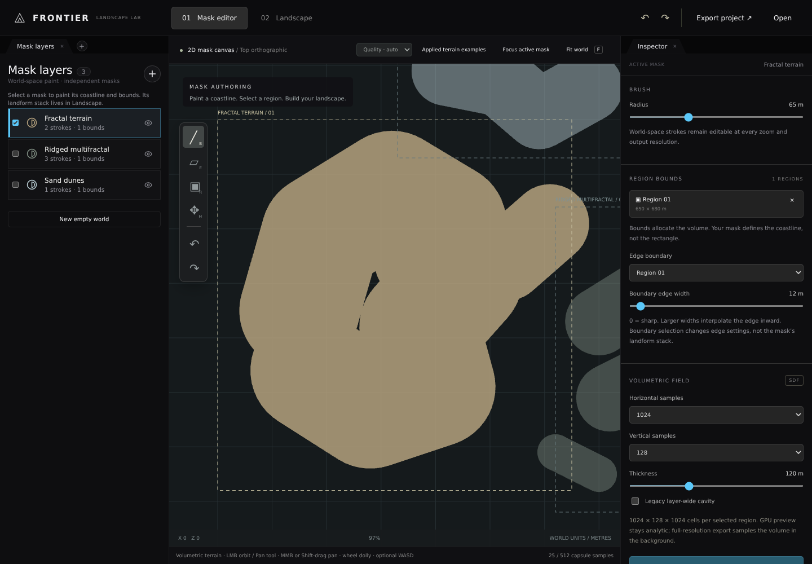
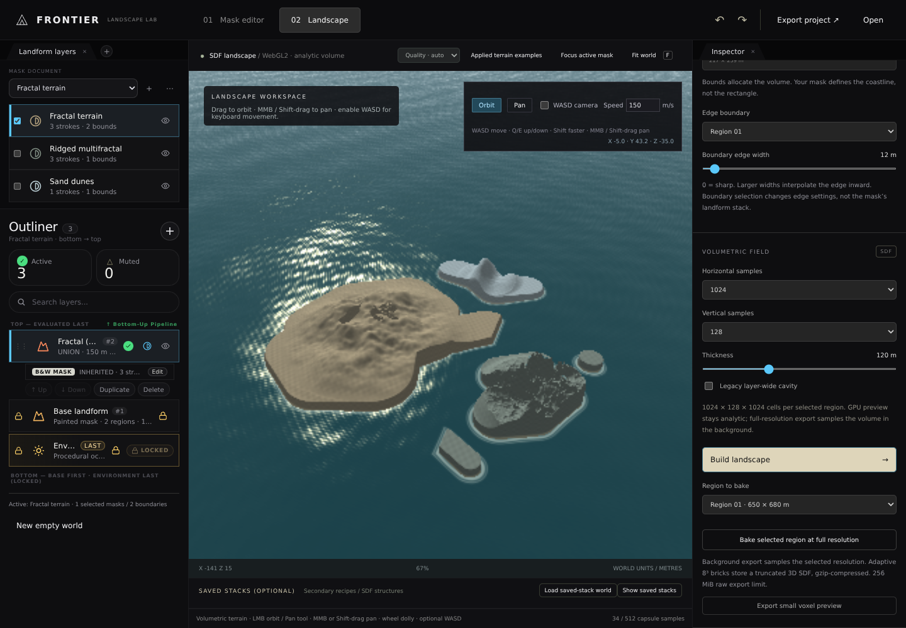
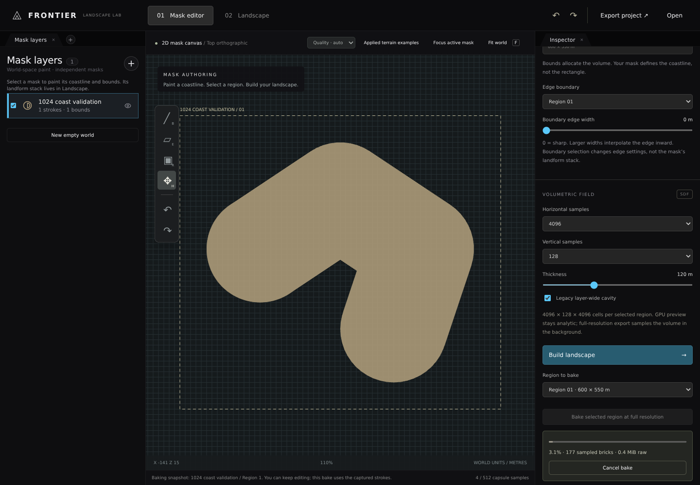
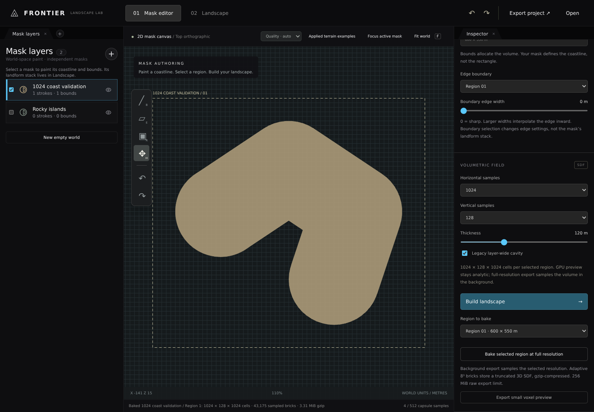

# Landscape workspace validation

## Results — 2026-11-06

Latest correction: [separate workspace stacks and flat-foundation radial terrain](RadialTerrain.md).

The [actual reference layer-stack UI](ReferenceLayerStack.md) remains in use for Landscape.
The earlier theme-only UI is superseded; actual reference row/menu styles and interactions are now used.
Fresh examples are already-applied noise terrains, not the older preset-first gallery.

| Verification                        | Observed result                                     |
|-------------------------------------|-----------------------------------------------------|
| Node field / stack / sparse tests   | 56/56 passed                                          |
| Playwright browser checks           | 9 current sea-level/radial checks passed; earlier suites retained                |
| GPU signed-field probes             | Interior negative; below/outside positive            |
| Vite production build               | Passed                                              |
| Actual UI captures                  | Canvas, landscape, bake progress and completion                    |
| Native Windows editor / physical GPU| Not tested; not represented by these browser results |

`BrowserResults.json` contains the individual interaction outcomes. `BakeResults.json` contains the numeric bake report. Captures are actual running application images,
not generated artwork. The landscape capture uses the reduced-resolution software-rendering fallback.

## Tested configuration

- Linux x64 (Debian 12), Node.js 22.22.3, Vite 7.3.7, Playwright 1.65.0.
- Chromium 153 from `@sparticuz/chromium` 153.0.0; WebGL2 through ANGLE / SwiftShader.
- Starting revision: `e1ce5629e8927ea1fc1b11646df21e7332687e68`, branch `arena/6c0074b7-frontier`.
- Relevant uncommitted changes: `Experimental/LandscapeWorkspace/`, this exhibit, and documentation links.
- Browser packages and extracted runtime libraries are local ignored tooling, not product binaries.

## Reproduce

```bash
cd Experimental/LandscapeWorkspace
npm ci
npm test
npm run build
npm install --no-save --package-lock=false @sparticuz/chromium@153.0.0
npm run dev -- --port 5173
```

In another terminal, run the retained interaction and capture script:

```bash
node Exhibits/LandscapeWorkspace/BrowserValidation.mjs
```

On a minimal Linux host lacking NSS/NSPR, extract the dependencies included in the Chromium package before launching:

```bash
cd Experimental/LandscapeWorkspace
node -e "require('fs').writeFileSync('/tmp/LandscapeLibraries.tar',require('zlib').brotliDecompressSync(require('fs').readFileSync('node_modules/@sparticuz/chromium/bin/al2023.tar.br')))"
mkdir -p /tmp/LandscapeLibraries
tar xf /tmp/LandscapeLibraries.tar -C /tmp/LandscapeLibraries
cd ../..
LD_LIBRARY_PATH=/tmp/LandscapeLibraries/lib node Exhibits/LandscapeWorkspace/BrowserValidation.mjs
```

The browser script checks painting, undo/redo, box selection, adding bounds, zoom/pan, shader creation, actual GPU field
signs, camera interaction, cave/ocean controls, vector project round-trip, sparse voxel download, empty-world reset,
4096-job cancellation, editing during a bake, and complete 1024 × 128 × 1024 gzip volume coverage.

## Limitations and earlier failures

- Initial browser launch failed because minimal-host NSS/NSPR libraries were absent; packaged libraries resolved it.
- Full-size software rendering caused an initial capture run to time out. Reduced-resolution software fallback was
  added; the complete suite then passed. This is not a physical GPU benchmark.
- Full-resolution baking now works; the old small JSON preview remains separately labelled. The new TSDF export
  has a 256 MiB uncompressed safety budget; 2048/4096 completion is not guaranteed for every shape.
- The landscape now supports regional basic signed-3D landforms and overhangs. Physical biome erosion and the full
  reference geological simulation are not implemented; see `Landforms.md`.
- CSG produces signed distance bounds at seams, not an exact global re-distance solution.
- Ocean waves use a non-tiled procedural directional sum. Physical realism and long-duration visual behaviour have not
  been quantitatively validated.

## Actual captures





## Full-resolution bake verification — continuation

```bash
node Exhibits/LandscapeWorkspace/BakeValidation.mjs
```

The retained coast fixture includes a 3D cavity. The script streams the actual encoder through gzip, validates
three sample locations in every leaf against the analytic truncated field, and retains only the results JSON.
It does not retain a large generated volume in Git. Measurements include sampling, numeric checks, and compression
on this Linux editing host, not a Windows or physical-GPU benchmark.

| Measurement                    | Observed                           |
|--------------------------------|------------------------------------|
| Actual grid                    | 1024 × 128 × 1024                    |
| Covered cells                  | 134,217,728 / 134,217,728            |
| Sampled 8³ bricks              | 43,175                             |
| Constant signed-distance leaves| 32,601                             |
| Encoded bytes                  | 90,069,135                         |
| Gzip bytes                     | 3,469,297                          |
| Checked sample locations       | 227,328                            |
| Maximum observed Float32 error | 1.192 × 10⁻⁷ world units            |
| Fixture run time               | 15.70 s, including numeric checks   |

A separate browser check completed a real 1024 × 128 × 1024 background bake, downloaded and decompressed the gzip,
checked its captured source layer and dimensions, and counted complete coverage from every leaf. It added another
layer during sampling to verify the UI was usable and that the original snapshot was preserved. The 4096 check
verifies cancellation only, not successful full completion at that resolution.





The complete 12-check browser suite also passed against the built Vite output (including its bundled background
sampling script), not only the development server. The retained `BrowserResults.json` and latest captures are from
that production-preview run. Reproduce it after `npm run build`:

```bash
cd Experimental/LandscapeWorkspace
npm exec vite preview -- --host 0.0.0.0 --port 5174
```

Then, in another terminal from repository root:

```bash
LD_LIBRARY_PATH=/tmp/LandscapeLibraries/lib LANDSCAPE_URL=http://localhost:5174 node Exhibits/LandscapeWorkspace/BrowserValidation.mjs
```

## Mask-owned landform stacks and preset examples

The current implementation supersedes the earlier boundary-owned primary-stack design. Every mask owns its own
`Layer.Landforms`; boundaries share it and retain separate edge widths. Fifteen focused production-browser checks
verify active-mask and explicit selected-mask scope, independent copies, atomic failure, import/undo, real preset
thumbnails/dialog, and background bake headers. 216 CPU/GPU probes agree within 0.000522 field units.

Current evidence: `MaskLayerStacks.png`, `PresetLibrary.png`, `MaskStackBrowserResults.json`, and
`LandformFieldResults.tap` (37 local tests). The twelve general browser checks were rerun against the same build.
See [the focused report and actual captures](Landforms.md). Earlier `LandformLandscape.png`, `BoundaryStacks.png`
and `LandformBrowserResults.json` document the superseded boundary-owned UI, not the current mask-stack design.
