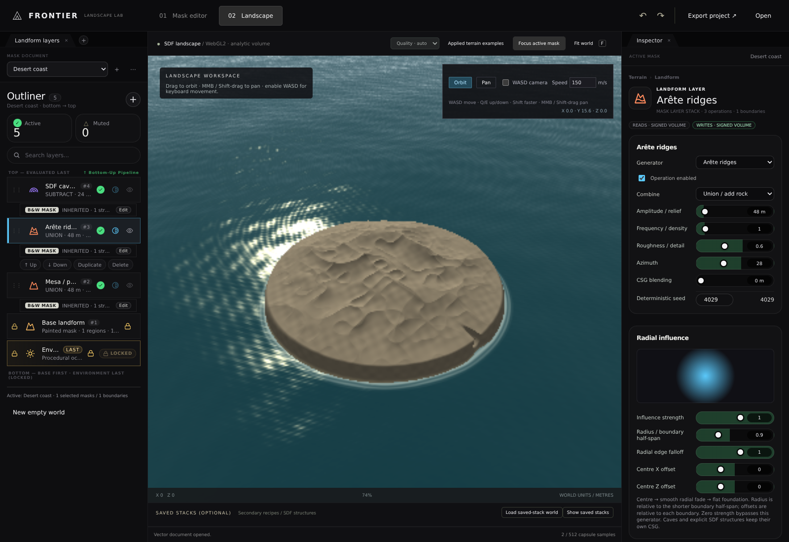
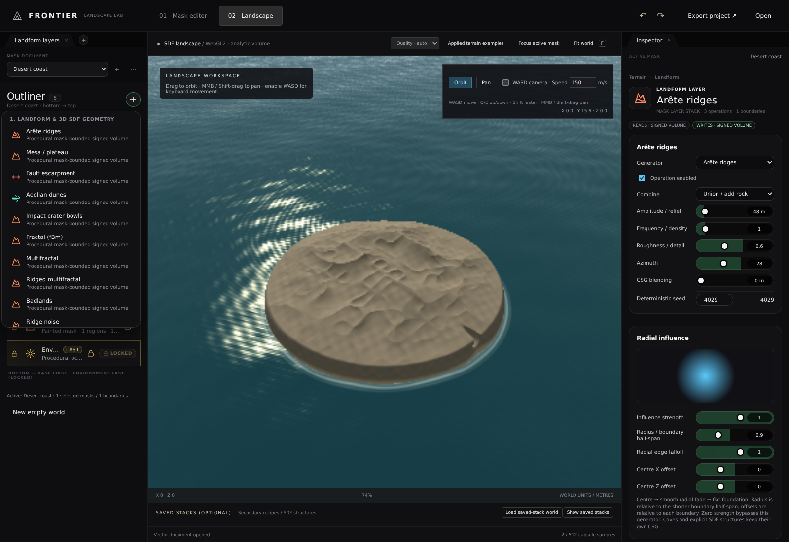

# Reference layer-stack UI redo

## Outcome — 2026-11-06

This revision replaces the earlier theme-only approximation and miniature nested operation cards with the reference's
actual stack presentation. The active mask's operations occupy the main outliner. The mask selector above it switches
between independent mask-owned stacks; batch-mask selection remains available through its adjacent menu.

| Verification                             | Observed result                                    |
|------------------------------------------|----------------------------------------------------|
| Local field / volume / camera / name tests| 46 / 46 passed                                     |
| New reference stack UI browser checks    | 11 / 11 passed against production output            |
| Mask ownership / stack browser checks    | 15 / 15 passed against the same output               |
| Terrain / navigation browser checks      | 9 / 9 passed against the same output                 |
| General regression browser checks        | 12 / 12 passed against the same output               |
| Original row vs applied row styles       | All 24 checked computed-style values match          |
| Source fingerprints                      | All six snapshots match upstream Git blob identities|
| Vite production build                    | Passed                                             |
| Native desktop / hardware GPU            | Not tested                                         |

Current results: `ReferenceStackBrowserResults.json`, `MaskStackBrowserResults.json`, `TerrainBrowserResults.json`,
`BrowserResults.json`, and `LandformFieldResults.tap`. There are 47 current browser checks in total.

## Actual source used

Requested branch: `https://github.com/c7egoist/Frontier/tree/arena%2F68c84c0d-frontier`.
Immutable revision: `09b7064f282f4df5c5352f2bc97c82fb1c06a098`.

- `src/erosion/layer-stack-ui.js`: row structure, glyphs, step numbers, visibility/mask controls, selection-only action
  strip, add-menu structure, search, duplicate/delete and drag-reorder behaviour.
- `src/app/style.css`: **full cascade**, including the final overrides that round surrounding controls, leave layer
  entries square and remove icon tiles. Earlier work missed those final rules.
- `index.html`: dock tabs, outliner title/count, active/muted counters, search and evaluation-order captions.
- These three originals now join the three existing reference snapshots. Their bytes and upstream Git blob identities
  are retained in `ReferenceSnapshot/SourcePin.json` and independently checked against the pinned Git tree.
- `ReferenceStack.css` is mechanically extracted from the actual stylesheet, preserving declaration order and cascade.
  `ExtractReferenceStackStyle.mjs` retains the reproducible extraction. Unrelated editor selectors are excluded.
- `StackGlyphs.js` uses the same Lucide package version (`1.66.0`), glyphs and source operation colours. There are no
  emoji substitutes or custom coloured icon tiles.
- `StackDock.css` integrates the reference components with the existing mask/volume workspace. It does not replace
  the reference layer-row geometry with a separately designed skin.

## Behaviour exercised

- Active-mask stack as the primary outliner, newest operation at top, numbered evaluation steps, painted foundation
  first and Environment locked last.
- Source add menu adds a real operation to the active mask; selection, Escape and outside click close it.
- Search filters names/types/summaries without altering any operation or the saved document.
- Selected row alone exposes **Up / Down / Duplicate / Delete**. Source eye controls mute real SDF operations and update
  the green/off status and active/muted counts. Keyboard row selection is also wired.
- Arrow controls and real HTML drag/drop persist ordering within the active mask; unrelated masks stay unchanged.
- Duplication creates independent operation objects. Renaming is saved, escaped in the UI and does not change geometry.
  Names are validated as nonempty strings of at most 96 characters; long duplicate names are safely truncated.
- The source inspector identity and pill-slider property card edit the actual active generator and numeric parameters.
- Mask selection switches stack ownership; selecting Foundation/Environment changes the inspector context and locks
  their positions. Environment is global procedural ocean/sky, not an extra geometry operation.
- Undo/redo, save/import, edge controls, batch scopes, noise generators, panning/WASD and full-resolution worker bakes
  remain verified. Existing source field evaluation and shader algorithms were not replaced by a heightmap.

## Direct reference comparison

The validation reads the **original row template** from the retained upstream `renderStackList()` method and evaluates
it with a deterministic display fixture. It renders that template using the **full original stylesheet** in a separate
page, then compares the working editor row against it. This is a reference component fixture, not a claim to execute
all of the upstream application or its geological simulation.

Matched values: eight row geometry/colour values, five icon values, three name values, two step-pill values, three
button values, two eye/mask glyph dimensions, and the cyan selection colour. Both actual rows are captured separately:

- `ReferenceStackOriginalRow.png`: original template plus full original stylesheet.
- `ReferenceStackAppliedRow.png`: the functioning editor component.

The comparison is exact for those computed properties; no whole-editor pixel-difference or full feature-parity claim
is made. The terrain backend remains local volumetric SDF. Mask controls edit inherited painted bounds rather than
creating unsupported per-operation height-channel masks. Read/write chips describe signed volumes or shading, not
upstream height/sediment channels. Unsupported simulation/vegetation stages are not exposed as fake working controls.

## Reproduction

Linux x64 / Debian 12; Node.js 22.22.3; Vite 7.3.7; Playwright 1.65.0; Chromium 153 / ANGLE SwiftShader.
Branch `arena/6c0074b7-frontier`, starting revision `e1ce5629e8927ea1fc1b11646df21e7332687e68`.
The cumulative prototype and UI changes are uncommitted; no GitHub Actions or native Windows build was run.

```bash
cd Experimental/LandscapeWorkspace
npm ci
cd ../..
node Exhibits/LandscapeWorkspace/ExtractReferenceStackStyle.mjs
cd Experimental/LandscapeWorkspace
npm test
npm run build
npm install --no-save --package-lock=false @sparticuz/chromium@153.0.0
npm exec vite preview -- --host 0.0.0.0 --port 5174
```

From root, with the browser runtime libraries described in the exhibit `README.md` installed:

```bash
LD_LIBRARY_PATH=/tmp/lib LANDSCAPE_URL=http://localhost:5174 \
  node Exhibits/LandscapeWorkspace/ReferenceStackBrowserValidation.mjs
LD_LIBRARY_PATH=/tmp/lib LANDSCAPE_URL=http://localhost:5174 \
  node Exhibits/LandscapeWorkspace/MaskStackBrowserValidation.mjs
LD_LIBRARY_PATH=/tmp/lib LANDSCAPE_URL=http://localhost:5174 \
  node Exhibits/LandscapeWorkspace/TerrainBrowserValidation.mjs
LD_LIBRARY_PATH=/tmp/lib LANDSCAPE_URL=http://localhost:5174 \
  node Exhibits/LandscapeWorkspace/BrowserValidation.mjs
```

The keyboard check waits for an actual camera-target change while the key is held, rather than assuming a fixed
350 ms frame turnaround on slow software rendering. No speed benchmark is inferred from that interaction check.

## Actual running application




