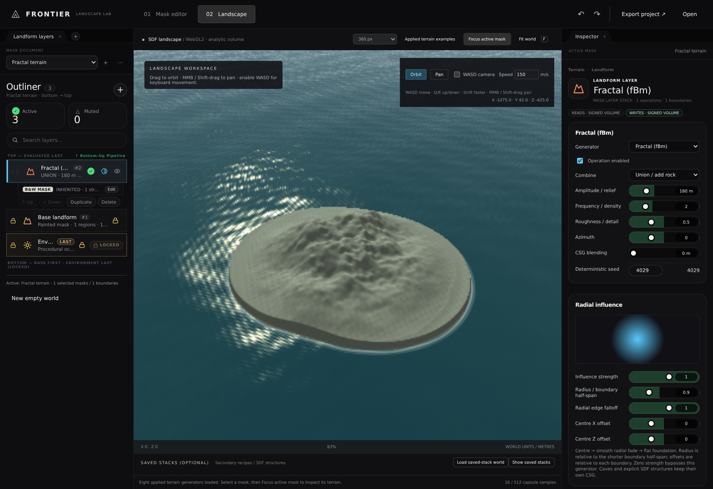
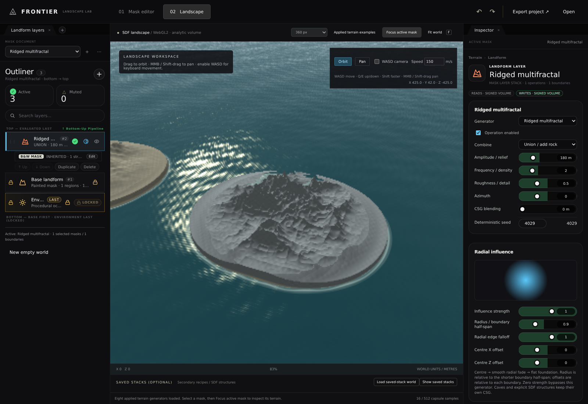

# Applied terrain generators and camera navigation

## Outcome — 2026-11-06

The latest correction supersedes the preset-gallery-first interpretation. Fresh documents open the landscape with
fractal, ridged multifractal and sand-dune generators **already applied**. Existing saved documents are preserved.
**Applied terrain examples** explicitly confirms replacement with eight separately editable generator masks; undo
restores the prior document. Select a mask and **Focus active mask** to inspect its actual terrain.

| Verification                         | Current result                                       |
|--------------------------------------|------------------------------------------------------|
| Local field / volume / camera tests   | 44 / 44 passed                                       |
| New terrain / navigation browser suite| 9 / 9 passed against production output                |
| Mask-owned stack browser suite       | 15 / 15 passed against the same build                 |
| General browser regression suite     | 12 / 12 passed against the same build                 |
| New noise CPU/GPU probes              | 280 points, seven generators, max error 0.000144       |
| Existing geometric CPU/GPU probes     | 216 points, nine adapters, max error 0.000522           |
| Production build                     | Passed, including worker and existing saved-stack PNGs|
| Native Windows / physical GPU speed  | Not tested                                           |

Individual results: `TerrainBrowserResults.json`, `MaskStackBrowserResults.json`, `BrowserResults.json`.
All 44 local results: `LandformFieldResults.tap`. Current captures: `AppliedTerrainGenerators.png` and
`AppliedRidgedMultifractal.png`. Captures wait for both the submitted camera target and document-upload revision to
finish on the GPU, not merely for the inspector selection to change.

## Implemented generators

| Generator           | Actual mechanism                                          |
|---------------------|-----------------------------------------------------------|
| Fractal (fBm)       | Four weighted octaves of seeded 3D lattice noise           |
| Multifractal        | Multiplicative octave contributions                        |
| Ridged multifractal | Multiplicative squared ridge-noise contributions           |
| Badlands            | Sharpened fourth-power ridge spectrum                      |
| Ridge noise         | Single-octave absolute/ridge transform                      |
| Fractal ridges      | Weighted multi-octave squared ridge spectrum                |
| Sand dunes          | Directional waves modulated by volumetric lattice noise    |
| Crater field        | Fractal terrain with bounded signed 3D crater excavation    |

These are local procedural adaptations, not a complete or numerically identical port of the reference's nineteen
height-texture generators. Badlands is geometric noise, not a physically eroded hydraulic simulation.
Arches, caves, rock stacks and stratigraphic structures remain compatible optional operations, in a separate selector
group; they are **not** presented as the terrain-generator examples.

`TerrainNoise.js` evaluates continuous seeded lattice noise in all three coordinates. CPU and GLSL use matched
32-bit integer hashing, cubic interpolation, octave transforms, persistence and multiplicative formulas. Analytic
gradient bounds normalize the implicit solid field for conservative marching and sparse sampling. No heightmap,
2D displacement texture, or dense global volume is introduced. Mask-owned CSG, overhangs, cavities, paint, erased
holes, regional clipping and individual edge widths remain supported. Existing documents are not silently rewritten.

The ray marcher uses up to 640 steps and a smaller field tolerance for procedural noise, rather than reusing the
160-step geometric-only budget. Single union-noise operations expose a conservative upper envelope, allowing exact
skipping when the regional clip dominates. This avoids unnecessary distant-region noise evaluation. Software auto
resolution and one in-flight submission remain; expensive scenes can still update slowly. No hardware performance
or exact Euclidean-distance reconstruction claim is made.

## Navigation

| Control                       | Behaviour                                             |
|-------------------------------|-------------------------------------------------------|
| Orbit / left drag             | Rotate around the target                              |
| Pan tool / left drag          | Translate without rotating                            |
| Middle mouse or Shift-drag    | Always pan, including in Orbit mode                    |
| Right drag or Space-drag      | Additional pan shortcuts                              |
| Wheel                         | Dolly                                                 |
| WASD camera checkbox          | Opt-in keyboard movement; off initially                |
| W / S                         | Forward / backward relative to camera yaw             |
| A / D                         | Strafe left / right relative to camera yaw             |
| Q / E                         | Up / down                                             |
| Shift                         | Three-times keyboard speed                            |
| Speed                         | World metres/second, bounded to 1–2000                 |

Diagonal movement is normalized. Key release, blur, visibility changes and disabling keyboard navigation clear held
movement. Input/select/textarea/contenteditable focus and modal dialogs block movement. Frame deltas are clamped to
avoid large jumps after inactivity. Keyboard navigation and panning change the camera, not mask stacks or undo history.

## Source UI alignment

Reviewed the actual pinned source, not just the earlier screenshot/theme interpretation:

- `index.html` at revision `09b7064f282f4df5c5352f2bc97c82fb1c06a098`: Outliner dock/tab, active/muted counters,
  add control, bottom-to-top layer list and inspector structure.
- `src/app/style.css` at the same revision: neutral charcoal dock `#0e0e10`, card `#141416`, selected card `#1c1f22`,
  cyan selection `#5ac8fa`, squared layer entries and hairline seams.
- These inform the local skin and controls. The inspector now exposes the actual active **Generator / operation**
  selector, amplitude, frequency, roughness, seed and CSG controls. Generator changes are undoable.
- This is a source-aligned volumetric editor adaptation, **not pixel-identical parity**, the complete source UI, or
  an implementation of its simulation/export buttons. Unsupported physical simulation controls are not fabricated.
- Saved-stack thumbnail recipes are secondary and collapsed initially; the principal examples are already on terrain.

The original source pin and three read-only reference snapshots remain unchanged in `ReferenceSnapshot/` and
`CLAUDE.md`. No upstream runtime shader import or new licence grant is implied.

## Reproduce

Same Debian 12 / Node.js 22.22.3 / Vite 7.3.7 / Playwright 1.65.0 / Chromium 153 SwiftShader environment as the
existing exhibit. Branch `arena/6c0074b7-frontier`, starting revision `e1ce5629e8927ea1fc1b11646df21e7332687e68`;
changes are cumulative and uncommitted. No GitHub Actions were run.

```bash
cd Experimental/LandscapeWorkspace
npm test
npm run build
npm exec vite preview -- --host 0.0.0.0 --port 5174
```

From root, with the browser/runtime dependencies described in `README.md` installed:

```bash
LD_LIBRARY_PATH=/tmp/lib LANDSCAPE_URL=http://localhost:5174 \
  node Exhibits/LandscapeWorkspace/TerrainBrowserValidation.mjs
LD_LIBRARY_PATH=/tmp/lib LANDSCAPE_URL=http://localhost:5174 \
  node Exhibits/LandscapeWorkspace/MaskStackBrowserValidation.mjs
LD_LIBRARY_PATH=/tmp/lib LANDSCAPE_URL=http://localhost:5174 \
  node Exhibits/LandscapeWorkspace/BrowserValidation.mjs
```




