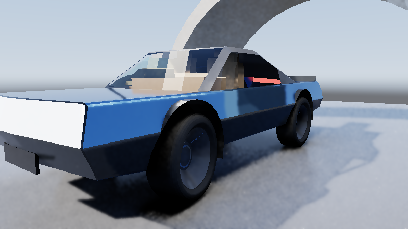
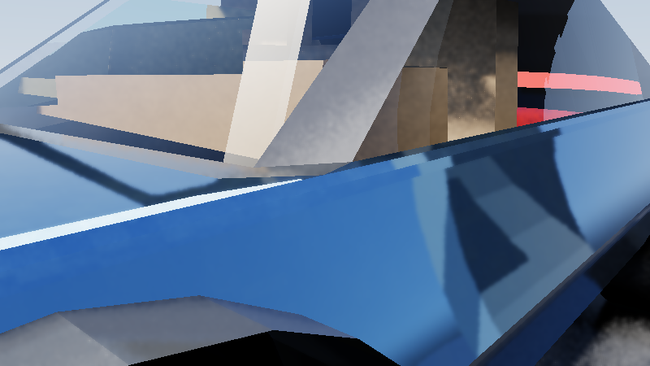
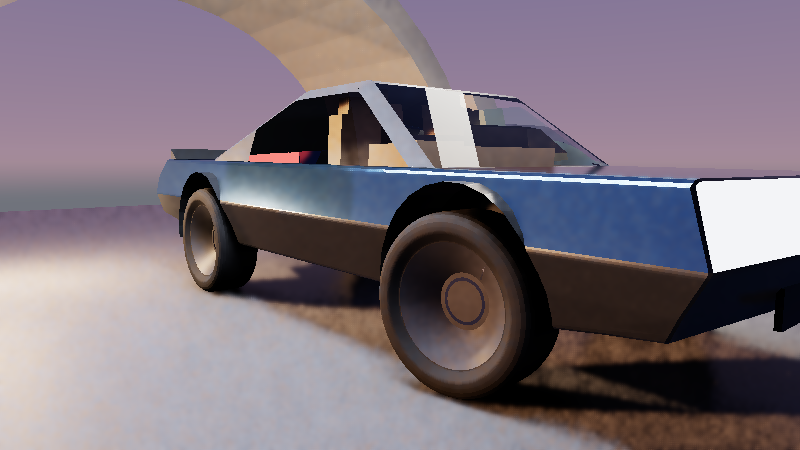

# Stage 3B: GTX-First `SpatiotemporalIllumination` (ReSTIR + `.sdfspace` SDF GI + Software SAH-BVH) Exhibits

End-to-end CPU + Vulkan 1.3 Slang compute verification for Frontier's **GTX-first (`0` hardware RTX raytracing extensions)**
Stage 3B renderer:

- **Headless `.sdfspace` Baker & Staged Volumes (`VolumeDistanceArchive`)**: UI-free wrapper over
  `Engine/ContentInterchange/VolumeDistanceField::BakeVolumeDistanceField` (exact Voronoi triangle seeding + 3D
  Felzenszwalb-Huttenlocher separable EDT + 3-axis parity sign), serialized as compact IEEE-754 `Float16` `.sdfspace`
  archives (`ControlVehicle{Body,Rim,Tyre}.sdfspace`, `607 KB` total) and staged automatically into `<Project>/Content/` at build time.
- **Software 16-Bin SAH `BoundingVolumeAtlas` (`BoundingVolumeSearch.slang`)**: Ordered child-slab compute BVH supporting
  closest-opaque visibility, two-interface curved dielectric Snell glass refraction peel (`IOR = 1.52 / 1.58`), and
  Beer-Lambert colored glass shadow transmittance on standard GTX compute queues.
- **`TextureWorkspace` Material Reuse (`SurfaceScatteringAtlas` + `SurfaceScatteringEvaluation.slang`)**: Bridges
  `Engine/Render/ScatteringSequence.h` (`ScatteringStratum` / `PreviewScattering`) and `Engine/Render/AutomotivePaint.h`
  (metallic basecoat flakes, polyurethane absorbing clearcoat, and Estevez-Kulla Charlie Alcantara cabin sheen).
- **4-Kernel `SpatiotemporalIllumination` (`SpatiotemporalIllumination.slang`)**: Weighted RIS over solar/rectangular-softbox/point
  luminaires, `M`-clamped temporal reservoir reuse, Jacobian-guarded spatial reservoir reuse, `.sdfspace` cosine-hemisphere
  diffuse GI + 5-tap SDF ambient occlusion, software BVH clearcoat/glass reflections, and edge-stopping 5x5 à-trous resolve.

## Vulkan 1.3 Stage 3B Showcase Captures (`800x450`)

| Capture | Verified Systems Shown |
|---|---|
|  | **Daylight Proving-Ground ReSTIR + `.sdfspace` SDF GI + Software BVH (`ControlVehicleProvingGroundRestirSdf.png`)**: Sun + dual rectangular studio softboxes resampled via ReSTIR, sapphire metallic clearcoat reflecting archway & tyre arches, translucent softbox reflection + Snell refraction on curved windshield, and SDF under-chassis occlusion. |
|  | **Close-Up Curved Windshield Snell Refraction & Clearcoat Reflections (`ControlVehicleCurvedGlazingRefraction.png`)**: Two-interface dielectric glass (`IOR = 1.52`) refracting Charlie-sheen Alcantara seats while reflecting studio softbox & sky dome via Schlick Fresnel. |
|  | **Multi-Light Twilight Studio ReSTIR + SDF Bounce (`ControlVehicleTwilightStudioRestirSdf.png`)**: 4 heterogeneous luminaires (low dusk sun, cool/warm rectangular softboxes, warm omni rim kicker) resolved in 3 temporal frames + 2 à-trous iterations. |
