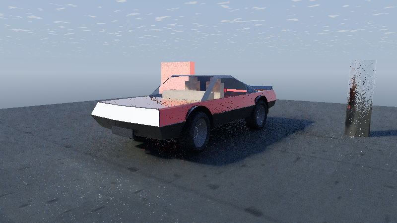
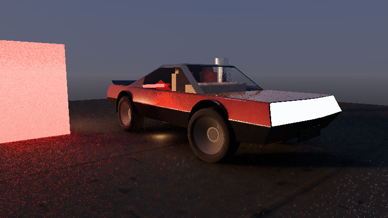
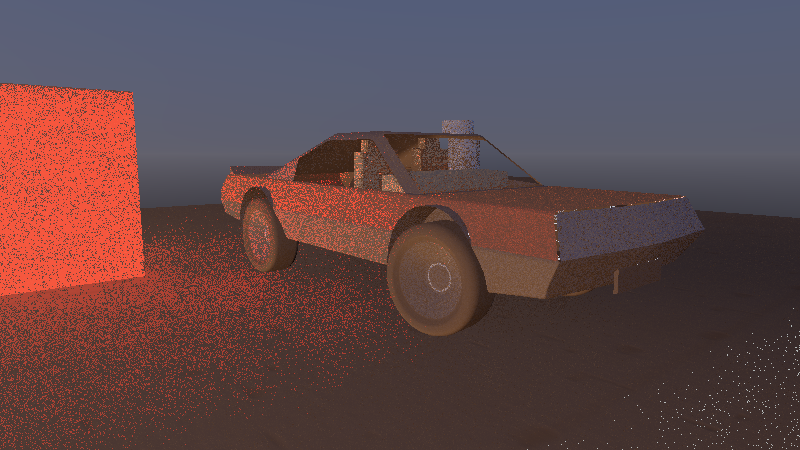
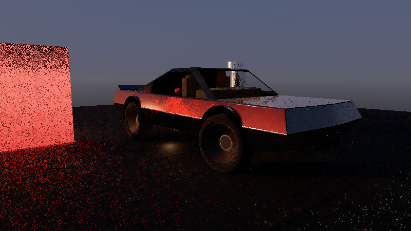
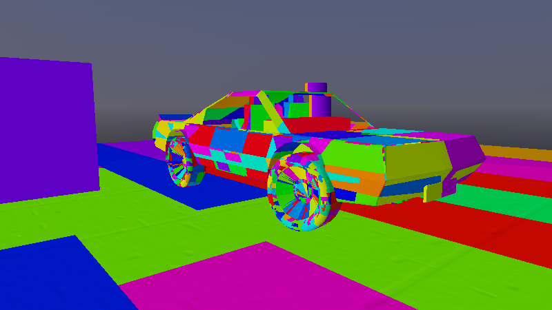

# Phase 3C: GTX-First `SpatiotemporalIllumination` — ReSTIR DI + ReSTIR GI + 8-Wide CWBVH + 4-Cascade SDF + Surface Cards

End-to-end CPU + Vulkan 1.3 Slang compute verification for Frontier's **GTX-first renderer** — every path below runs on
ordinary compute queues with **zero hardware RTX ray-query extensions** (`0` `VK_KHR_ray_query` / `VK_KHR_ray_tracing_*`).

## What this phase added (and honestly replaced)

Phase 3B shipped a four-kernel baseline: linear-refraction glass, a *filled* (not RIS) light loop, one SDF grid, and one
reflection ray. Phase 3C replaces each of those with the production structure and says so explicitly.

| Subsystem | Phase 3B baseline | **Phase 3C (this exhibit)** |
|---|---|---|
| Acceleration structure | Single-level binary SAH BVH | **Two-level instanced TLAS + quantized 8-wide CWBVH BLAS** (Ylitie–Karras–Laine), `23267` binary cells collapse to `4212` wide cells over the same `25532` triangles |
| Surface normals | Geometric (flat) only | **Octahedral crease-smoothed vertex normals** (locked 58.7° crease threshold) interpolated barycentrically |
| Dielectric optics | Linear `lerp` "bend" | **Exact unpolarized Fresnel + Snell vector refract + total-internal-reflection detection** (`EvaluateDielectricBoundary`) |
| Light sampling | Uniform analytic loop | **Weighted RIS over solar + analytical luminaires + flux-weighted emissive facet CDF**, then shadow-verified |
| Direct lighting | RIS, temporal reuse | RIS + temporal reuse **+ Jacobian-guarded spatial reuse** |
| Indirect lighting | 1 SDF grid + tint approximation | **True ReSTIR GI** over a **4-cascade clipmap SDF**, shaded by **GPU SurfaceCard multi-bounce radiosity** |
| Reflections | 1 jittered ray | **Heitz (2018) stretched-ellipsoid VNDF sampling with a base/coat mixture PDF** and exact throughput weights |
| Specular estimator | Unbounded | **VNDF lobe + documented single-sample firefly bound** (unbounded clearcoat peaks alias to white) |
| Denoiser | Shared diffuse/spec à-trous, constant sigma | **Split diffuse/specular demodulation with a `>= 6/255` representable albedo floor, real second moment, and hit-distance-guided specular taps** |
| Environment | Analytic gradient | **`AtmosphereProjection` SkyView LUT + lunar corona haze + procedural cloud deck + ForceField dust fog + optical lens flare** |
| Presentation | Host readback | **Zero-copy `RGBA8` storage target** suitable for `ImGui_ImplVulkan_AddTexture` (ACES + exact sRGB + triangular dither) |
| Telemetry | Frame counters | **Per-kernel hardware `VkQueryPool` timestamps** (`DispatchTimingSample`), VRAM accounting, pipeline compile ms, persistent `VkPipelineCache` |

## Pipeline (six low-VGPR kernels + two radiosity kernels)

```
BoundingVolumeAtlas      → TLAS + 8-wide CWBVH + octahedral normals        (CPU, once)
VolumeDistanceArchive    → 4-cascade clipmap .sdfspace + analytic primitives (CPU, once)
SurfaceCardRadiositySolver → InjectCardDirectIrradiance (GPU)              (per solar change)
                           → IterateCardRadiosityBounce  x3 (GPU)           (Jacobi B = E + g·ρ·F·B)
SurfaceScatteringAtlas   → 8x float4 strata table + 2D-array PBR textures   (CPU + upload)

TracePrimarySurface            → two-level ray + 2-interface Snell/TIR peel + motion vectors
SampleDirectReservoirs         → solar/analytic/emissive-CDF RIS + shadow verify + temporal reuse
SampleIndirectReservoirs       → cosine GI over CWBVH (near) / 4-cascade SDF (far) + temporal reuse
ReuseSpatialReservoirs         → spatial DI + Jacobian GI + VNDF reflections + split demodulation
FilterSpatiotemporalAtrous     → split diffuse (σ from local moments) / specular (hit-distance) à-trous
ResolveSpatiotemporalDisplay   → remodulate, glass composite, environment, 15 inspection modes, ACES, RGBA8
```

## Verified results (SwiftShader Vulkan 1.3, this host)

| Check | Result |
|---|---|
| `.sdfspace` Float16 round-trip | ✅ interior/on-surface/exterior errors `< 2e-3 m` |
| 8-wide CWBVH vs binary SAH traversal | ✅ **256 / 256** probed rays agree (`122` hits, `< 2.5e-3 m`) |
| Dielectric boundary arithmetic | ✅ normal-incidence `F = 0.042567` vs analytic, grazing `> 0.55`, glass→air TIR detected |
| Flux-weighted emissive CDF | ✅ `5536` facets, `132.6 W` total flux, every sampled point lit |
| CPU vs GPU SurfaceCard radiosity | ✅ **max |Δ| = 1.79e-7** over 15 cards x 3 bounces (`gpu = 0.9 ms`) |
| Heitz VNDF white furnace | ✅ `0.977` (smooth) / `≈1.0` (rough): energy conserving |
| 3-tier Material LOD thresholds | ✅ Near → FullStrata, Mid → Toksvig, Far → CompactProxy |
| Temporal rejection after camera jump | ✅ post-teleport frame is a valid non-degenerate image |

**Not measured here:** GTX hardware timing and latency. SwiftShader is a software Vulkan implementation, so the per-kernel
millisecond figures (`~20 s` per 800x450 frame) are *not* GTX performance indicators. Run the same validation on the GTX
1650 SUPER host to obtain those numbers; the CSV/timestamp plumbing is already in place.

## Retained captures (`800x450`, written by `--write-showcase`)

| Capture | Verified systems shown |
|---|---|
|  | **Daylight proving ground** — ReSTIR DI + ReSTIR GI over 4-cascade SDF, instanced column BLAS through the TLAS, SurfaceCard radiosity bounce onto the underslung body, cloud deck and dust fog. |
|  | **Curved glazing close-up** — 2-interface Snell refraction + TIR path through the windshield, clearcoat body reflections that catch the terracotta baffle and column. |
|  | **Twilight studio** — four heterogeneous luminaires (low dusk sun, cool/warm softboxes, warm omni rim) resolved with 6 temporal frames. |
|  | **Inspection mode 9 (GI)** — the ReSTIR GI reservoir radiance plus SurfaceCard exitance: red baffle bleed and contact darkening, no direct sun term. |
|  | **Inspection mode 8 (reflections)** — Heitz VNDF base/coat mixture: the bodywork mirror-reflects the bright sky (the reason the hood reads near-white) while tyres stay matte. |
|  | **Inspection mode 12 (clusters + material tier)** — per-cluster golden-ratio identity tinted by the active 3-tier Material LOD. |

## Known limitations (stated, not hidden)

1. **SwiftShader only.** No GTX run was performed in this environment; all timings are software Vulkan.
2. **Rough reflections are noisy at low frame counts.** The split denoiser uses a documented firefly clamp plus a real
   second moment, but 4–6 frames is not a converged path tracer. More frames or higher spatial reuse converges further.
3. **The bright hood is physical, not a bug.** Clearcoat + sky = a bright sky reflection; inspection mode 3 (base colour)
   confirms the paint underneath is the authored candy crimson.
4. **Two-interface Snell uses the thin-sheet exit approximation** when the interior back-face hit is not found within
   0.35 m (a 6.5 mm laminated sheet); thick-solid transport with caustics is still a later phase.
5. **Surface cards are 6-axis boxes + a ground grid**, not per-cluster captures.
6. **Pre-existing unrelated failures:** `StampWorkspacePanelConstructionValidation`, `DockCycleRecoveryValidation`, and
   `FrameFaultRecoveryValidation` abort identically with this change set stashed, so they are not regressions from Phase 3C.

## Reproduce

```bash
cmake -S . -B build -G Ninja -DFRONTIER_HOST_VERIFICATION=ON -DGLFW_BUILD_WAYLAND=OFF -DGLFW_BUILD_X11=OFF
cmake --build build -j "$(nproc)"
ctest --test-dir build -R SpatiotemporalIlluminationValidation --output-on-failure
# add --write-showcase to mirror the captures into Exhibits/SpatiotemporalIllumination/Images/
```

| Item | Value |
|---|---|
| Platform | Linux x86-64, GCC 12.2.0, `-std=c++20` |
| Shader compiler | Slang `spirv_1_3`, `-O0 -emit-spirv-directly` |
| GPU | SwiftShader Device (Subzero), Vulkan 1.3.0 |
| Tested revision | this branch's Phase 3C commit (see `git log`) |
