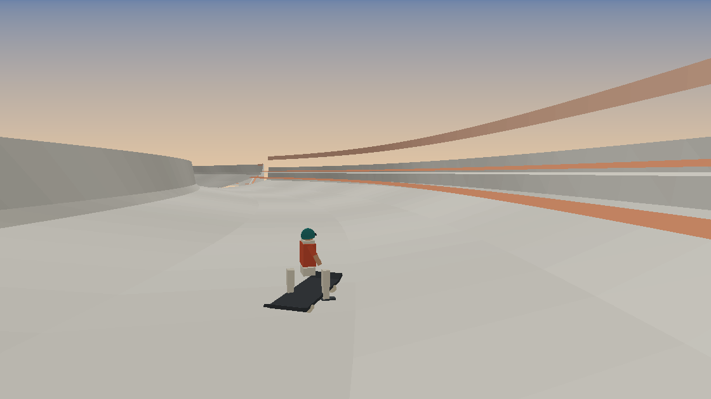

# Spillway — Aqueduct Run

A browser-playable arcade racer prototype built for a Frontier request:

> a racing game like Subway Surfers, with ramps, tunnels, overhead bridges, skate-park roads,
> and 90° turns to drift, in the spirit of *Ready Player One* — but not another neon city.

The answer to the "no neon" brief is a place instead of a palette: a colossal concrete
storm-drain spillway at golden hour. Chalk-white poured walls, ochre desert below, salt water
in the settling basins, rusted steel gantries, stencilled maintenance boards. The rider is a
skater on a longboard. It is bright, dry, and enormous rather than dark and electric.



## Play it

```text
cd Experimental/Spillway
node tools/serve.mjs 8080
```

Open `http://localhost:8080`. Any static server works; the page needs no build step.
three.js r170 is vendored in `vendor/` (MIT, licence included), so it runs offline.

| Input | Action |
|---|---|
| `A` / `D` or `←` / `→` | Carve across the deck |
| `Space` / `Shift` | Hold to drift, release to slingshot |
| `Esc` | Pause · `R` restarts from pause |
| `M` | Mute |
| Touch | Steer pads and a drift button appear on coarse pointers |

## The loop

The course is generated ahead of the rider forever and dismantled behind them. Six road types
repeat with different architecture:

| Section | Road | What it asks of you |
|---|---|---|
| Deck | Long flat channel between 1.9 m walls | Line up for the next elbow |
| Pump track | Rollers that throw you off every crest | Carry speed, land clean |
| Bowl | Parabolic skate bowl 4.2 m deep | Use the transition for air |
| Kicker | Ramp with a hard lip and a steep backside | Launch, or drop |
| Tunnel | Ribbed sluice with slit roof and sun shafts | Hold a line, no run-off |
| Overpass | Massive span crossing overhead | Thread the piers at speed |
| Chute | 5.8 m half-width channel between 6 m walls | Nerve, no margin |
| Cascade | Spillway stair, four drops then a climb | Pump the drops |
| Basin | Shallow sheet of water across the channel | Skim, splash, scrub speed |
| Lift | Climbing aqueduct between buttresses | Regain altitude |
| 90° turn | 20–24 m wide elbow, banked to the outside | **The drift** |

### Why drifting is the whole game

The rider never brakes. A 90° elbow throws `v²/R` of centrifugal load at them; unequipped, the
rider slides wide into the outer wall and loses speed, multiplier and charge. Holding drift
cancels most of that load, lets the carve hold an inside line, banks the multiplier and fills
the charge bar. Releasing converts the charge into a slingshot. Measured in the harness:

| Run (180 s, same seed) | Distance | Score | Wall hits |
|---|---|---|---|
| Drifting the elbows | 8 983 m | 107 651 | 6 |
| Steering only, never drifting | 8 255 m | 41 046 | 4 |
| No input at all | 8 093 m | 51 588 | 32 |

Ramps, rollers and bowl transitions hand out airtime with clean-landing bonuses; landing
sideways or from height bails the multiplier and scrubs speed.

## Art direction

- **Place:** spillway, not city. Aqueduct decks on 20–30 m piers, a dam and reservoir on the
  horizon, terraced blocks on the basin rim, birds working the thermals.
- **Light:** low golden-hour sun, 2 048² shadow map that travels with the rider, ochre bounce,
  cool rim from the opposite side, exponential haze.
- **Surfaces:** every texture is drawn at runtime on a canvas — form-board joints, tie holes,
  alkali streaks, aggregate speckle, wind-rippled sand, sheet water, stencilled signage. No image
  files, no network requests.
- **Markings:** hard red lip lines with cream insets, rumble chequers at elbow entries, teal crest
  bands on kickers, stencilled signs on the walls and gantries.
- **UI:** printed park sign, not a HUD hologram. Cream paper, vermillion rule, condensed type,
  tabular telemetry, no glow.

## Structure

| Path | Responsibility |
|---|---|
| `index.html` | Title card, telemetry HUD, pause sheet, touch pad |
| `styles/screen.css` | Printed-sign interface, grain overlays, responsive layout |
| `src/path.js` | Course generator: chunk sequence, arcs, elevations, cross-sections |
| `src/ride.js` | Rider motion, drift grip, airtime, wall contact, scoring |
| `src/geometry.js` | Section sweeps, piers, tunnels, overpasses, gantries, paint, signs, water |
| `src/world.js` | Sky, sun, desert floor, distant terrain, reservoir, birds, dust, shadow rig |
| `src/rider.js` | Low-poly skater model and pose animation |
| `src/audio.js` | Synthesised wind, roll, carve hiss, tunnel hush, impacts |
| `src/hud.js` | DOM telemetry and transient tickets |
| `src/main.js` | Boot, streaming, camera, input, effects |
| `tools/validate.mjs` | Headless course/mesh/ride verification and SVG course map |
| `tools/preview.mjs` | Software rasteriser that renders the built scene to PNG |
| `tools/serve.mjs` | Zero-dependency static launcher on `0.0.0.0` |

`path.js` and `ride.js` import nothing, so the same maths the browser runs is verified in Node.

## Verification

Run from this folder:

```text
node tools/validate.mjs    # assertions + Results/Verification.md
node tools/preview.mjs     # software-rendered Results/Preview*.png
```

- Course continuity, section validity, 74 k triangles over 40 chunks, no non-finite vertices.
- Ride simulation: no NaN over three 180 s runs, drifting outscores cruising, ignoring the elbows
  doubles the wall hits, ramps actually launch.
- HUD driven through a real DOM (jsdom) and checked field by field.
- Full application booted headlessly against a stub WebGL context: menu demo, start, 900 frames,
  chunk streaming and disposal, pause and resume, no exceptions.

Not verified in this environment: actual GPU rasterisation, shader compilation, audio output and
real pointer input, because the sandbox has no browser. `Results/Preview*.png` are software
rasterisations of the real scene geometry, not browser screenshots.

## Limits

Prototype scope: endless run, no career, no leaderboards, no replay. The course repeats section
archetypes indefinitely; the fun comes from speed, line and the elbows.
